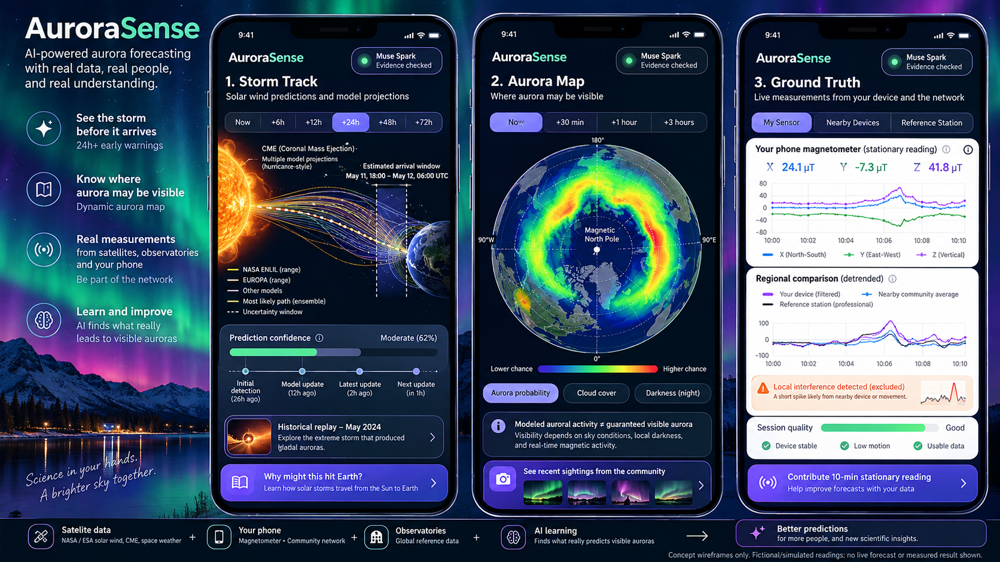

# AuroraSense

**See the storm. Find the aurora. Measure Earth's response.**

AuroraSense connects solar-storm forecasts, modeled auroral activity, and citizen smartphone ground magnetic measurements in a single inspectable scientific workflow. Its central research question is: **can quality-controlled smartphone magnetometers add useful independent information about regional geomagnetic disturbances?** An inconclusive answer is a valid scientific result.

**Meta Global AI Developer Hackathon · Indie Developer Track · Theme: Push the Frontier (and Build for Your World)**  
**Submission Deadline:** November 4, 2026, 9:00 PM `America/New_York` (November 5, 02:00 UTC).

**Status, November 1, 2026:** Complete local production web application (`apps/web`), three-screen native Expo mobile recorder (`apps/mobile`) matching the approved dark-navy/teal/violet/amber wireframe, interactive **7-Step Citizen Science Journey** (`[ 1. Understand ] ➔ [ 2. Spot Finder ] ➔ [ 3. Measure ] ➔ [ 4. AI Insights ] ➔ [ 5. Compare ] ➔ [ 6. Red-Team ] ➔ [ 7. Alerts ]`), AI-assisted interference & object signature recognition, Brian Eno *Bloom*-inspired ambient harmonic field sonification, Prescriptive Diagnostic Evaluation (color-coded Green/Yellow/Orange bars), Central Citizen Magnetometer Database (`/api/recordings`), Meta AI Multi-Model Suite (`/api/meta` & `/api/agent`), and reproducible Python scientific experiments (**101 TypeScript tests** and **28 Python tests** passing).

> [!IMPORTANT]
> **Scientific & Competition Transparency:** The browser coordinator includes a deterministic **SCRIPTED POLICY DEMO — NO MODEL CALL** mode so judges and users can inspect the full 7-tool agent workflow offline without credentials, while `/api/meta` (`runLiveMetaSparkInsight`) and `/api/agent` execute live `muse-spark-1.3` calls against `https://api.meta.ai/v1/responses` when server-side `META_MODEL_API_KEY` is configured (and explicitly label `LOCAL_DETERMINISTIC_EVALUATOR` / `503 AGENT_NOT_CONFIGURED` when unconfigured). Actual Meta model execution is a Stage-1 competition gate; see [Competition readiness](#competition-readiness).


---

## Contents

- [For Hackathon Judges: Rubric Alignment & Key Innovations](#for-hackathon-judges-rubric-alignment--key-innovations)
- [The 7-Step Citizen Science Journey](#the-7-step-citizen-science-journey)
- [Three-Screen Wireframe Architecture (Web & Mobile)](#three-screen-wireframe-architecture-web--mobile)
- [Meta AI Developer Suite & 7-Tool Agentic Architecture](#meta-ai-developer-suite--7-tool-agentic-architecture)
- [Real-World Smartphone Evidence & Prescriptive Evaluation](#real-world-smartphone-evidence--prescriptive-evaluation)
- [Start the Demo (60-Second Web Quickstart)](#start-the-demo-60-second-web-quickstart)
- [Run the Phone Recorder (iOS & Android)](#run-the-phone-recorder-ios--android)
- [Test Every Screen & API Endpoint](#test-every-screen--api-endpoint)
- [Three-Minute Demonstration Runbook](#three-minute-demonstration-runbook)
- [What Works and What Remains](#what-works-and-what-remains)
- [Scientific Results and Python Reproduction](#scientific-results-and-python-reproduction)
- [Verification and CI](#verification-and-ci)
- [Competition Readiness](#competition-readiness)
- [Prepare a Safe GitHub Release](#prepare-a-safe-github-release)
- [Sources, Licenses and Documentation](#sources-licenses-and-documentation)
- [Troubleshooting](#troubleshooting)

---

## For Hackathon Judges: Rubric Alignment & Key Innovations

AuroraSense is engineered specifically for the **Meta Global AI Developer Hackathon** judging criteria:

| Judging Criterion | Weight | How AuroraSense Delivers |
|---|---:|---|
| **Impact** (*Push the Frontier* & *Build for Your World*) | **30%** | Turns consumer smartphones into quality-controlled citizen magnetometer nodes. Bridges the gap between space-weather satellites (1.5M km upstream at L1), sparse professional observatories (USGS INTERMAGNET), and everyday aurora chasers/power-grid observers—while preventing false alarms through strict physical quality control. |
| **Use of Meta AI Tooling** | **25%** | Integrates the **Meta AI Suite** across the scientific pipeline: **`muse-spark-1.3`** as a bounded 7-tool scientific coordinator (`/api/agent`) and real-time measurement & interference analyst (`/api/meta`), **`muse-wonder`** for red-team scientific invariant auditing, **`muse-image`** for 5-stage magnetospheric reconnection visual education, and **`sam-3.1`** optical sky segmentation specifications for separating aurora from clouds and light pollution. Never fabricates a model call or lets LLM prose override the deterministic validator. |
| **Technical Depth & Execution** | **20%** | Full monorepo (`apps/web`, `apps/mobile`, `packages/shared`, `packages/coordinator`, `science/`, `supabase/`) with **101 passing TypeScript tests**, **28 passing Python scientific tests**, 3-axis accelerometer + touch + magnetometer sensor fusion, ambient Web Audio / PCM harmonic synthesis, event-blocked ridge regression benchmark on 2,191 training / 851 held-out cases, and real 10-minute physical iPhone 14 Pro Max windowsill telemetry (`62.01 nT` baseline MAD). |
| **Demo & User Experience** | **25%** | Sleek dark-navy/teal/violet/amber UI faithful to the approved three-screen wireframe on both Desktop/Mobile Web and native Expo iOS/Android, guided by the intuitive **7-Step Citizen Science Journey** and color-coded Green/Yellow/Orange **Prescriptive Diagnostic Evaluation** cards. |

---

## The 7-Step Citizen Science Journey

Both the mobile app (`apps/mobile`) and web dashboard (`apps/web`) guide users through an interactive, visual-first, gamified 7-step workflow from discovering their phone's magnetic forcefield to live space-weather alerting:

```text
[ 1. Forcefield ] ➔ [ 2. Quiet Spot ] ➔ [ 3. Solar 3D ] ➔ [ 4. Scan & QC ] ➔ [ 5. NOAA/NASA ] ➔ [ 6. Phone Net ] ➔ [ 7. Alerts ]
```

1. **Step #1 · 3D Live Forcefield & Gamified AI Object Scavenger Hunt (`[ 1. Forcefield ]`):**
   - Renders an interactive **3D Smartphone & Toroidal Magnetic Forcefield (`MagneticField3DView`)** at the top center of the screen (drag to orbit in 3D!) paired with **Brian Eno *Bloom*-inspired ambient harmonic drone sonification**.
   - **Gamified 3-Object Scavenger Hunt:** Challenges users to unlock three real-time badges by bringing everyday items near the phone: **🖐️ Wave Hand / Touch** (`0.4–3.8 µT`), **⌚ Smartwatch / Magnet** (`4–60 µT` steep `1/r³` dipole gradient), and **💻 Laptop / Charger Cable** (AC switching jitter).
   - Displays a visual **AI Magnetic Fingerprint Radar** (`Spike Δ|B|`, `Gradient Speed dB/dt`, `Dipole Focus`) with 1-tap buttons to confirm & train new object signatures.
2. **Step #2 · Gamified Quiet-Spot Purity Radar (`[ 2. Quiet Spot ]`):**
   - Features a live **`0–100%` Earth-Signal Spot Purity Gauge** with a color-coded **Red / Yellow / Green** bar (`> 250 nT` Noisy, `100–250 nT` Fair, `< 100 nT` Pure) and 4 live hazard indicators (**🧑 Humans/Hands**, **🏗️ Metal/Magnet**, **⚡ Wires/Laptop**, **🪟 Still Surface**) to guide placement onto a clean windowsill or table.
3. **Step #3 · AI Earth-Signal Detector, 3D CME Magnetosphere & 1859 Carrington Superstorm (`[ 3. Solar 3D ]`):**
   - Computes a live **AI Earth-Field & Solar-Wind Coupling Likelihood (`0–100%`)** score verifying whether the sensor is measuring Earth's real core/ionospheric magnetic field (`~25–65 µT`, ultra-slow `nT` drift) rather than man-made noise.
   - Includes an interactive **3D Sun–to–Earth Magnetosphere & CME Simulator (`SolarStorm3DView` / `SolarMagnetosphere3DCanvas`)**:
     - Tap **"☀️ Tap to Fire CME"** to launch a 3-part Coronal Mass Ejection from the Sun and watch bow-shock compression, Kelvin-Helmholtz vortices (Dr. Katariina Nykyri's May 2024 G5 study), nightside magnetotail reconnection snapping, and polar aurora precipitation in 3D!
     - Switch between **🌤️ Quiet Wind**, **🌌 May 2024 Mother's Day G5 Storm**, and **🔥 1859 Carrington Superstorm** (when induced ground currents literally set telegraph machines on fire, and why a modern repeat poses a `$2.4 Trillion` risk to power grids and satellites).
4. **Step #4 · Fast 30s Quick Scan (or 2m / 10m Pro) & AI Quality Verdict (`[ 4. Scan & QC ]`):**
   - Users can choose **⚡ 30s Quick Scan** (for instant interactive feedback without waiting 10 minutes), **🎯 2m Standard Scan**, or **🔬 10m Pro Observatory Mode**, with automatic upload to the Central Citizen Magnetometer Database (`/api/recordings`).
   - Evaluates the recording via color-coded **Green / Yellow / Orange** diagnostic bars (**Sensor Quietness** & **Space Weather Excursion `Δ|B|`**) and **Meta `muse-spark-1.3`** quality synthesis.
5. **Step #5 · Visual Comparison with Live NOAA / NASA & Human Impact Dials (`[ 5. NOAA/NASA ]`):**
   - Compares **Your Phone (`Δ|B|`)** side-by-side against **NOAA SWPC DSCOVR Solar Wind** (`Speed km/s`, `IMF Bz nT`), **USGS Boulder (`BOU`)** fluxgate magnetometer traces, an interactive **Kp Index Storm Comparison Chart** (May 2024 G5 vs. Typical / G2 / G3), and **4 Human Infrastructure Impact Dials** (`Power Grid`, `Satellites`, `GPS / Nav`, `HF Radio`).
6. **Step #6 · Multi-Phone Citizen Network & Red-Team Gate (`[ 6. Phone Net ]`):**
   - Displays incoming citizen smartphone recordings across the network alongside reference observatories, audited by the **Meta `muse-wonder` Red-Team Gate** and deterministic validator (`run_regional_coherence`, requiring `≥ 3` independent sites separated by `≥ 5–20 km` before upgrading `INCONCLUSIVE` to `SUPPORTED`).
7. **Step #7 · Per-Phone Location-Aware Aurora Storm Alerts (`[ 7. Alerts ]`):**
   - Lets users select their phone's latitude zone (`Fairbanks`, `Tromsø`, `Reykjavik`, `Helsinki`, `Boulder`), view their live **Aurora Storm Readiness %**, subscribe to automatic storm alerts, and trigger an instant **Incoming Storm Push Alert Preview**.

---

## Three-Screen Wireframe Architecture (Web & Mobile)

AuroraSense implements the approved three-screen visual architecture across both Web (`apps/web`) and native Mobile (`apps/mobile`), with a shared **Historical Replay (`2024-05-11 03:00 UTC`) / Live NOAA** clock and contextual **Why?**, **Research**, and **Muse Spark** drawers:



| Screen | Purpose & Scientific Provenance | Key Controls |
|---|---|---|
| **1. Storm Track** | Tracks CME propagation from Sun to Earth using the verified **May 2024 NASA CCMC CME Scoreboard** ensemble (`2024-05-08T12:24:00-CME-001`: **10 original pre-outcome submissions** across **7 distinct methods**, `19.9 h` full / `15.2 h` pre-shock arrival spread vs. observed shock `2024-05-10 16:45 UTC`) and live **NOAA SWPC solar wind** (`IMF Bz` GSM `nT`, speed `km/s`). | Shared `Replay / Live` clock slider, `Refresh NOAA`, expandable submission provenance inspector, `Why?` 5-stage reconnection drawer. |
| **2. Aurora Map** | Separates three distinct evidence layers on a polar geographic graticule: **(1) Modeled Activity** (live NOAA OVATION 30–90 min aurora probability grid; explicitly marked unavailable in 2024 replay so current data is never relabeled as historical), **(2) Measured Ground Response** (USGS `BOU` reference + QC-screened citizen sites), and **(3) Confirmed Optical Sightings** (`NONE LOADED`, `Cloud cover: Unknown`). | `Northern / Southern` hemisphere, `Twilight shading`, coarse viewing region pin (`Boulder`, `Fairbanks`, `Tromsø`, `Reykjavik`, `Hobart`). |
| **3. Ground Truth** | Real-time 3-axis smartphone magnetometer (`X / Y / Z · DEVICE FRAME` in `µT`, `1 µT = 1,000 nT`), scalar residual `Δ|B|` in `nT` against the first 120-second baseline, **Prescriptive Diagnostic Evaluation** (Green/Yellow/Orange bars), **7-Step Citizen Science Journey**, and **USGS Boulder (`BOU`)** comparison. | Mode switcher (`📊 Sensor & Wireframe View` / `🧭 7-Step Citizen Journey`), ambient harmonic audio toggle, JSON/CSV/QC export, Central DB sync, and `Muse Spark` 7-tool coordinator. |

---

## Meta AI Developer Suite & 7-Tool Agentic Architecture

```text
Next.js / TypeScript (apps/web) & Expo Recorder (apps/mobile)
 ├── NASA CCMC / NOAA SWPC / USGS BOU verified provenance fixtures & live NOAA refresh
 ├── Real-time Sensor Fusion (Magnetometer µT + Accelerometer m/s² + Touch + Ambient Audio)
 ├── Prescriptive Diagnostic Evaluator & Central Citizen Magnetometer DB (/api/recordings)
 └── Meta AI Multi-Model Suite (/api/meta & /api/agent)
      ├── muse-spark-1.3 ──► 7 Typed Scientific Tools + Live Measurement & Object Insights
      ├── muse-wonder    ──► Red-Team Scientific Invariant & Physics Audit
      ├── muse-image     ──► 5-Stage Magnetospheric Reconnection Visual Concepts
      └── sam-3.1        ──► Optical Aurora Sky Segmentation & Cloud Masking Schema
```

### The Seven Approved Typed Scientific Tools (`packages/coordinator`)

The `muse-spark-1.3` coordinator agent operates under strict server-derived roles, JSON schema validation, token/round budgets, and append-only audit logging across exactly seven tools:

| Tool | Responsibility |
|---|---|
| `get_event_context` | Retrieves sourced CME scoreboard, solar-wind, and time-anchor constraints for the active event. |
| `get_regional_coverage` | Queries independent citizen magnetometer site coverage in the authorized coarse geographic cell and UTC window. |
| `get_reference_magnetometers` | Loads compatible professional observatory reference series (`USGS BOU` 1-minute adjusted fluxgate in `nT`). |
| `run_local_qc` | Evaluates deterministic acquisition quality (`phone-qc-0.1.0`: cadence, gaps, 120s baseline MAD `< 250 nT`, spikes, rotation/motion). |
| `run_regional_coherence` | Computes deterministic multi-site temporal alignment, spatial independence (`≥ 3` sites, `≥ 5 km`), reference correlation, and canonical verdict (`SUPPORTED / INCONCLUSIVE / REJECTED`). |
| `request_opt_in_session` | Dispatches a rate-limited, cell-scoped observation invitation to an already opted-in adult (never activates sensors remotely). |
| `publish_evidence_report` | Publishes the audited evidence report while locking the deterministic validator's verdict against narrative override. |

---

## Real-World Smartphone Evidence & Prescriptive Evaluation

### Accepted 10-Minute Quiet Windowsill Run (October 31, 2026 · iPhone 14 Pro Max)

Using the **Spot Finder** and **Prescriptive Diagnostic Evaluation** workflow, we recorded a full 10-minute (`599.903 s`) stationary session on a granite windowsill (`2026-10-31T18:30:27.274Z` to `18:40:27.177Z`):

| Metric | Measured Value | Engineering Gate / Scientific Meaning |
|---|---|---|
| **Sample Count & Cadence** | `5,985 samples` (`9.977 Hz`, `0 gaps > 0.5 s`) | **100% locally usable coverage** across the full 10-minute window. |
| **Fixed 120s Baseline (`|B|`)** | `46.085 µT` (`46,085 nT`) | Realistic ambient Earth total field magnitude in device frame. |
| **Baseline Noise Floor (`MAD`)** | **`62.01 nT`** (Placement Score: `88 / 100`) | **PASSES (`< 100 nT` Green Optimal Tier)** and well below the `250 nT` QC rejection gate (`0` local flags). |
| **Sustained Excursion (`Δ|B|` 95%)** | **`432.5 nT`** (Peak trough: `-924.6 nT`) | Progressive downward drift across Minutes `2–6` (`-114 nT` median) and Minutes `6–10` (`-158 nT` median). |
| **Canonical Regional Verdict** | **`LOCALLY USABLE · REGIONALLY INCONCLUSIVE`** | Honest scientific verdict: a single stationary smartphone cannot separate a regional geomagnetic perturbation (`G3–G4` candidate scale) from unmeasured local building/HVAC/thermal drift without `≥ 3` co-temporal independent sites and professional observatory alignment. |

Earlier physical tests on October 28, 2026 (a partial 3,042-sample interference run stopped on backgrounding and a 5,987-sample run with `801 nT` baseline MAD) are also preserved in [docs/phone-experiment-2026-10-28.md](docs/phone-experiment-2026-10-28.md) to demonstrate that the unchanged QC pipeline rejects noisy sessions honestly.

---

## Start the Demo (60-Second Web Quickstart)

### Requirements

- **Node.js 24**, `npm`, and a modern desktop or mobile browser.
- **Python 3.12** (optional for the web UI; used for running the scientific test suite and offline ML reproduction).
- **Physical smartphone with Expo Go (SDK 58 compatible)** (optional for the web demo; used for live native magnetometer acquisition).

Clone the repository, open a terminal in its root, and run:

```sh
npm ci
npm run build
npm run start --workspace @aurorasense/web
```

Open **[http://127.0.0.1:3000](http://127.0.0.1:3000)** in your browser (use `npm run dev` for hot-reloading development).

- **Zero API keys or cloud accounts are required for the local demo.** Saved historical replay, interactive 7-Step Citizen Science Journey, Prescriptive Diagnostic Evaluation, local phone JSON import, deterministic QC, Central Citizen DB simulation (`/api/recordings`), and scripted 7-tool coordinator replay work out of the box.
- **Optional Live Meta AI API Execution:** To enable live `muse-spark-1.3` inference on `/api/meta` and `/api/agent`, copy [`env.local.example`](env.local.example) to `apps/web/.env.local` and set `META_MODEL_API_KEY`.

---

## Run the Phone Recorder (iOS & Android)

The native Expo foreground recorder lives in `apps/mobile` with its own lockfile. After running `npm ci` at the repository root:

```sh
npm ci --prefix apps/mobile
npm start --prefix apps/mobile
```

1. Scan the Expo QR code on a physical iPhone or Android phone (on iPhone, ensure Expo Go and Expo CLI are signed into the same Expo account via `npx expo login`).
2. Use the bottom tab bar to switch between **`1. Storm Track`**, **`2. Aurora Map`**, and **`3. Ground Truth`**, or open the **`Why?`**, **`Research`**, and **`Muse Spark`** drawers from the header.
3. On **`3. Ground Truth`**, toggle between **`📊 Sensor & Wireframe View`** and **`🧭 7-Step Citizen Journey (Step #1–#7)`**:
   - Listen to the **Brian Eno *Bloom*-inspired ambient harmonic drone** react in pitch as you move your hand or a smartwatch near the phone (mute anytime via **`🔊 / 🔇`**).
   - Watch the **AI Interference & Spot Finder** classify hand proximity, device motion, or nearby electronics until you place the phone on a quiet non-magnetic surface (`🟢 < 100 nT`).
   - Enable **Adult (18+)** and **Foreground Recording Consent**, run a recording, and tap **`Send to DB`** or **`Export JSON` / `Export QC`** to inspect the session in the web dashboard.

See [the full physical sensor protocol](docs/sensor-experiment.md) for detailed hardware guidelines.

---

## Test Every Screen & API Endpoint

Use the production build (`http://127.0.0.1:3000`) at desktop width (`1280 px`) and mobile responsive width (`390 × 844 px`):

### A. Storm Track and Shared Clock
1. Start on **Storm Track → Historical replay** (`2024-05-11 03:00 UTC`).
2. Confirm **10 original submissions**, **7 distinct methods**, and a **19.9 h** arrival-estimate spread (`15.2 h` among pre-shock submissions). Open **Inspect original submissions and revisions** to verify method, submission UTC, and arrival-estimate UTC.
3. Drag **Replay time** backward and forward: submissions appear strictly according to their historical submission timestamp.
4. Switch to **Live** and click **Refresh NOAA** to inspect real-time NOAA SWPC `IMF Bz` (GSM `nT`) and solar-wind speed (`km/s`) with explicit issuance/retrieval timestamps.

### B. Aurora Map
1. In **Historical replay**, select **Aurora Map**: verify that the historical OVATION layer is honestly marked **unavailable** (no verified 2024 OVATION grid is fabricated).
2. Switch to **Live**: inspect the NOAA OVATION aurora oval, toggle **Northern / Southern** hemisphere, **Twilight shading**, and **Coarse viewing region** (`Boulder`, `Fairbanks`, `Tromsø`, `Hobart`), and verify that **Confirmed Optical Sightings (`NONE LOADED`)** and **Clouds (`Unknown`)** remain distinct from modeled geomagnetic activity.

### C. Ground Truth, 7-Step Citizen Journey & Prescriptive Evaluation
1. Select **Ground Truth**. Inspect the **7-Step Citizen Science Journey** banner (`[ 1. Understand ] ➔ ... ➔ [ 7. Alerts ]`) at the top of the screen.
2. Click **Import sensor JSON** and select either:
   - The committed synthetic test fixture: `demo/fixtures/synthetic-phone-local-interference.json` (`SYNTHETIC` provenance, 1,601 samples over 160 s, 12 µT spike at 135–140 s, rotation at 145–148 s ➔ local QC rejection), or
   - Your own exported raw phone session JSON (`phone-*-json.json`).
3. Inspect the **Prescriptive Diagnostic Evaluation** section (*What Your Phone Recording Actually Means*):
   - Verify the color-coded **Sensor Placement Quietness** bar (Green `< 100 nT`, Yellow `100–250 nT`, Orange/Red `> 250 nT`),
   - Verify the **Space Weather Activity Level** bar (`0–600+ nT` across G1–G5 scales) and the 3-stage timeline (`Minutes 0–2`, `Minutes 2–6`, `Minutes 6–10`).
4. Click **Submit Recording to Central Citizen DB** to test `/api/recordings` and inspect the **Meta AI Multi-Model Suite** cards (`muse-spark-1.3`, `muse-wonder`, `sam-3.1`, `muse-image`) with explicit `executionMode` and `modelCalled` badges.

### D. Coordinator, Why?, Research & Fail-Closed Backend Verification
1. Click **Run policy workflow** (`SCRIPTED POLICY DEMO · NO MODEL CALL`) to inspect the 7-tool sequence, local spike rejection, opt-in adult follow-up request, and canonical **`INCONCLUSIVE`** verdict.
2. Open **Why?** to step through the 5-stage magnetospheric reconnection walkthrough and **Research** to inspect the held-out ML forecasting benchmark and downloadable audit trail.
3. Verify fail-closed `/api/agent` behavior when cloud credentials are unconfigured:
   ```sh
   curl.exe -i -X POST http://127.0.0.1:3000/api/agent -H "Content-Type: application/json" -d "{}"
   ```
   Expect **`503 Service Unavailable` (`AGENT_NOT_CONFIGURED`)** with zero fabricated model calls.

---

## Three-Minute Demonstration Runbook

A three-minute video is required by the hackathon participant guide. Follow [demo/recording/runbook.md](demo/recording/runbook.md):

| Time | Segment | What to Show & Highlight |
|---|---|---|
| `0:00–0:25` | **Step #1 & #2: Understand & Spot Finder** | Mobile app live field display, Brian Eno *Bloom*-style harmonic audio reacting to hand/watch proximity, and AI interference classifier guiding placement onto a quiet windowsill (`< 100 nT` Green). |
| `0:25–0:55` | **Step #3 & #4: 10-Min Measurement & Prescriptive AI Insights** | The 10-minute granite windowsill recording (`62.01 nT` quiet baseline MAD, `432.5 nT` sustained excursion), Green/Yellow/Orange diagnostic bars, and `muse-spark-1.3` analysis. |
| `0:55–1:25` | **Screen 1: Storm Track & NASA Ensemble** | May 2024 NASA CCMC CME Scoreboard (10 submissions, 7 methods, 19.9 h spread) and live NOAA SWPC solar wind (`IMF Bz`, speed). |
| `1:25–1:50` | **Screen 2: Aurora Map & SAM 3.1 Layering** | Polar OVATION aurora grid, twilight boundary, coarse viewing pins, and separation of modeled activity vs. ground sensors vs. optical sky segmentation. |
| `1:50–2:30` | **Step #5 & #6: USGS Comparison, 7-Tool Agent & Wonder Red-Team** | Compare phone trace with USGS `BOU`, run the 7-tool `muse-spark-1.3` coordinator + `muse-wonder` red-team audit, and show why `< 3` independent sites honestly yield `INCONCLUSIVE`. |
| `2:30–3:00` | **Step #7, Held-Out ML Benchmark & Why? Reconnection** | Personalized aurora alert readiness, held-out OMNI ➔ USGS `BOU` regression scores, and the 5-stage `Why?` reconnection explainer. |

---

## What Works and What Remains

| Capability | Working Now | Remaining Validation / External Gates |
|---|---|---|
| **Three screens, 7-Step Citizen Journey, Why?, Research** | Complete on both production Web (`apps/web`) and native Mobile (`apps/mobile`) | Final 3-minute video capture |
| **Real-time Sensor Fusion & Harmonic Audio** | 3-axis magnetometer + accelerometer motion + touch tracking + *Bloom*-style Web Audio/PCM drone + AI object classifier | Tested on iPhone 14 Pro Max; Android hardware run remains optional |
| **Physical Phone Acquisition & Prescriptive QC** | Three inspected iPhone 14 Pro Max exports, including accepted 10-min quiet windowsill run (`62.01 nT` MAD, 100% usable) | Single-device regional verdict remains honestly `INCONCLUSIVE` (`< 3` sites) |
| **NASA CCMC & NOAA SWPC Integration** | Verified May 2024 ensemble (10 submissions / 7 methods) + live NOAA solar wind & OVATION refresh | Historical 2024 OVATION grid intentionally omitted (not fabricated) |
| **Meta AI Suite (`muse-spark-1.3`, `wonder`, `image`, `sam-3.1`)** | 7 typed tools, `/api/meta` live `runLiveMetaSparkInsight` adapter + deterministic fallback, `/api/agent` adapter, scripted replay | Requires owner's `META_MODEL_API_KEY` in `apps/web/.env.local` for live Stage-1 API trace |
| **Central Citizen DB & Supabase Persistence** | Local JSON/memory `/api/recordings` aggregation + 3 SQL migrations, RLS policies & pgTAP suite in `supabase/` | Hosted Supabase deployment and live multi-user ingestion remain optional external setup |
| **Scientific ML & Signal Filtering** | Event-blocked ridge benchmark (2,191 train / 851 test) + 432-injection GP filter transmission study (`science/`) | Retrospective OMNI availability proxy; phone forecast benefit untested |

---

## Scientific Results and Python Reproduction

### Python Environment Setup

Windows PowerShell (from repository root):

```powershell
py -3.12 -m venv .venv
.\.venv\Scripts\python.exe -m pip install -r science/requirements.txt
.\.venv\Scripts\python.exe -m unittest discover -s science/tests -v
.\.venv\Scripts\python.exe -m science.experiments.learn --offline
```

macOS / Linux:

```sh
python3.12 -m venv .venv
.venv/bin/python -m pip install -r science/requirements.txt
.venv/bin/python -m unittest discover -s science/tests -v
.venv/bin/python -m science.experiments.learn --offline
```

### Frozen Forecasting Comparison (`OMNI` ➔ `USGS BOU X`)

Predicts mean ground magnetic response in `[t+30, t+35]` minutes relative to the preceding 1-hour median across three 2023 training blocks (**2,191 complete cases**) and two held-out 2024 test blocks (**851 complete cases**) with a minimum 24-hour embargo:

| Model | Held-out MAE (`nT`) | Held-out RMSE (`nT`) |
|---|---:|---:|
| **Persistence baseline** | `29.09` | `61.38` |
| **Simple southward-coupling ridge baseline** | `32.82` | `64.45` |
| **Instantaneous + prior ground ridge** | **`29.08`** | **`58.12`** |
| **History + prior ground candidate** | `29.48` | `58.69` |

Worse-than-baseline candidate scores (`29.48 nT` MAE for the history candidate vs. `29.09 nT` persistence) are reported without post-hoc threshold tuning. See [docs/science-methods.md](docs/science-methods.md), [docs/evaluation-results.md](docs/evaluation-results.md), and [docs/ai-phone-filtering.md](docs/ai-phone-filtering.md).

### Core Scientific Invariants (`AGENTS.md`)

- **Units & Frames:** Smartphone axes are **DEVICE-frame `µT`** (`1 µT = 1,000 nT`). Cross-station comparisons use scalar magnitude residuals (`Δ|B|`) in `nT` across aligned UTC windows, never raw device-frame X/Y/Z against geographic North/East/Vertical (`H/D/Z`).
- **Distinct Timestamps:** Measurement, forecast issuance, forecast validity, operational availability, and retrieval times are kept strictly separate.
- **Deterministic Regional Gate:** A single device or co-located household pair can never establish a regional geomagnetic storm (`SUPPORTED` requires `≥ 3` independent sites separated by `≥ 5 km` plus professional reference alignment). Model prose cannot override the deterministic validator.

---

## Verification and CI

Run all verification checks from the repository root:

```sh
npm run typecheck
npm run typecheck --prefix apps/mobile
npm run lint
npm test
npm run build
```

**November 1, 2026 Verified Local Results:**
- `npm run typecheck` (`@aurorasense/shared`, `@aurorasense/coordinator`, `@aurorasense/web`): **Passed (`0 errors`)**
- `npm run typecheck --prefix apps/mobile`: **Passed (`0 errors`)**
- `npm run lint`: **Passed (`0 errors, 0 warnings`)**
- `npm test` (Vitest): **101 passed across 11 test files**
- `npm run build` (Next.js 16.4.3 production build): **Succeeded**
- `python -m unittest discover -s science/tests -v`: **28 passed**

Managed CI ([`.github/workflows/verify.yml`](.github/workflows/verify.yml)) runs bounded web/coordinator, Python science, and mobile verification jobs automatically on GitHub push/PR.

---

## Competition Readiness

Checked against the [Meta Global AI Developer Hackathon page](https://cerebralvalley.ai/e/meta-ai-developer-hackathon), [Participant Guide](https://cerebralvalley.ai/e/meta-ai-developer-hackathon/details), and [Official Rules](https://cerebralvalley.ai/e/meta-ai-developer-hackathon/waiver):

| Readiness Item | Status & Action |
|---|---|
| **Track & Theme** | **Indie Developer Track** · **Push the Frontier** (physical sensing & scientific experimentation) |
| **Open Source Repository** | Public GitHub repository required; MIT License ([`LICENSE`](LICENSE)) + [`THIRD_PARTY_NOTICES.md`](THIRD_PARTY_NOTICES.md) |
| **Original Hackathon Contributions** | Documented in [`docs/hackathon-contributions.md`](docs/hackathon-contributions.md) |
| **Stage-1 Meta Model Use Gate** | Adapter, 7 tools, and `/api/meta` + `/api/agent` routes are complete; owner must supply `META_MODEL_API_KEY` in `apps/web/.env.local` to record a live `muse-spark-1.3` run before submitting |
| **Three-Minute Demo Video** | Follow [`demo/recording/runbook.md`](demo/recording/runbook.md) and submit via the [official portal](https://cerebralvalley.ai/e/meta-ai-developer-hackathon/hackathon/submit) before **Nov 4, 2026, 9:00 PM ET** |

---

## Prepare a Safe GitHub Release

`.gitignore` excludes credentials (`.env*` except examples), `data/raw/`, `data/private/`, `data/database/`, `science/private/`, raw phone exports (`phone-*-*.json`), and screen recordings (`*.mp4`). Before committing and pushing to a public GitHub repository, run:

```sh
git status --short --untracked-files=all
git check-ignore data/private/release-probe.json data/raw/release-probe.json apps/web/.env.local phone-example-json.json
git add --dry-run .
```

Verify that no secrets, personal raw recordings, or precise user coordinates are staged, then commit and push to your public GitHub repository.

---

## Sources, Licenses and Documentation

Original code is licensed under [MIT](LICENSE). External scientific datasets retain their respective agency terms; credit **NASA CCMC and forecast teams, NASA GSFC/SPDF OMNIWeb, NOAA SWPC, USGS Geomagnetism Program (Boulder `BOU`), and C. L. Stanton's Broomfield archive**. No agency endorsement is claimed.

| Path | Purpose |
|---|---|
| [`apps/web/`](apps/web/) | Next.js 16 web application, 7-Step Citizen Journey, Prescriptive Evaluation, `/api/meta`, `/api/recordings`, `/api/noaa`, `/api/agent` |
| [`apps/mobile/`](apps/mobile/) | Expo SDK 58 native recorder (`StormTrackScreen`, `AuroraMapScreen`, `GroundTruthScreen`, `SevenStepsGuidedJourney`, `MuseSparkDrawer`) |
| [`packages/shared/`](packages/shared/) | Sensor contracts, deterministic QC (`phone-qc-0.1.0`), interference classifier, prescriptive diagnostic evaluator |
| [`packages/coordinator/`](packages/coordinator/) | Seven typed scientific tools, regional coherence validator, `muse-spark-1.3` / `wonder` / `image` / `sam-3.1` adapters |
| [`science/`](science/) | Data acquisition, GP denoising transmission study, event-blocked ML benchmark, 28 Python unit tests |
| [`supabase/`](supabase/) | PostgreSQL migrations, Row-Level Security (RLS) policies, and pgTAP test suite |
| [`docs/`](docs/) | [`progress.md`](docs/progress.md), [`science-methods.md`](docs/science-methods.md), [`evaluation-results.md`](docs/evaluation-results.md), [`sensor-experiment.md`](docs/sensor-experiment.md), [`agent-backend.md`](docs/agent-backend.md) |

---

## Troubleshooting

| Symptom | Action |
|---|---|
| **Missing modules** | Run `npm ci` at root; for mobile also run `npm ci --prefix apps/mobile`. |
| **Port 3000 occupied** | Stop the other process or run `npm run start --workspace @aurorasense/web -- --port 3001`. |
| **Phone cannot reach computer** | Ensure phone and computer are on the same LAN, or run `npx expo start --tunnel` inside `apps/mobile`. |
| **Recording stops on app switch** | By design: non-active `AppState` immediately halts capture so background gaps never corrupt scientific time series. |
| **Import fails** | Import the raw session file (`phone-*-json.json`), not the `-qc.json` summary report (8 MB max). |
| **Single-phone recording says `INCONCLUSIVE`** | Expected scientific invariant: one phone validates local sensor quietness (`62.01 nT`) and candidate excursions (`432.5 nT`), while regional confirmation requires `≥ 3` independent sites and USGS reference alignment. |
| **`/api/agent` returns `503`** | Expected fail-closed behavior when `META_MODEL_API_KEY` and Supabase credentials are not set in `apps/web/.env.local`. |
