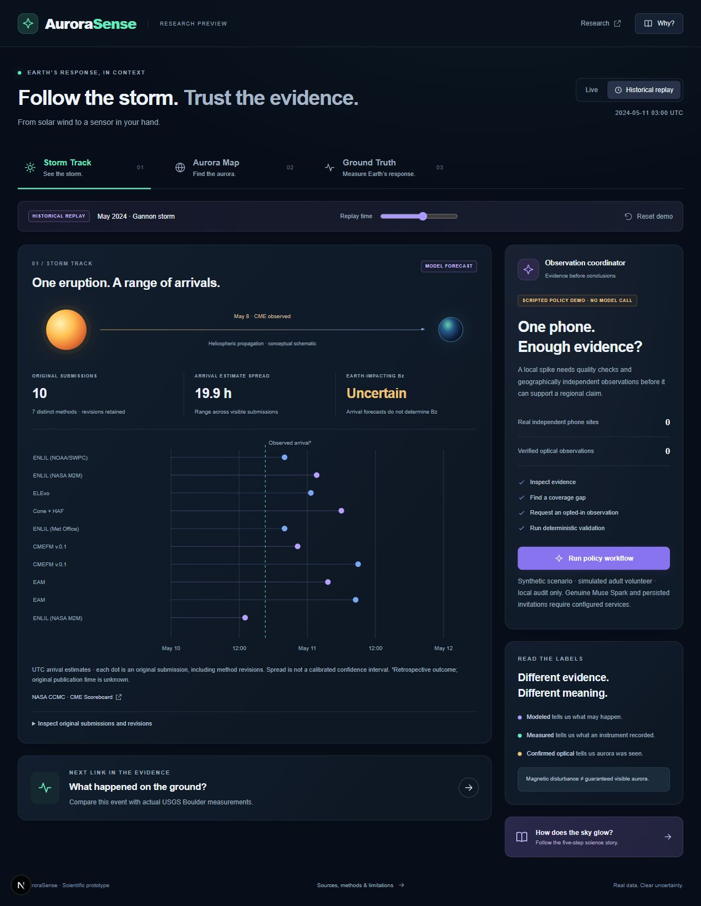

# AuroraSense

**See the storm. Find the aurora. Measure Earth's response.**

A scientific observation prototype connecting NASA CME forecasts, NOAA auroral/solar-wind models, professional ground magnetometers and real phone measurements. Its central question is whether quality-controlled phones can add useful independent information about regional geomagnetic disturbances. **That hypothesis remains unresolved.**

Meta Global AI Developer Hackathon · **Indie Developer** · **Push the Frontier**
Deadline: **November 4, 2026, 9:00 PM America/New_York** (November 5, 02:00 UTC).

**Source:** [kkrat0s/aurorai](https://github.com/kkrat0s/aurorai) · **Demo recording:** [2:55 shot list](demo/recording/video-script-2026-11-04.md) · [Narration](demo/recording/voiceover-2026-11-04.txt) · [Requirements and remaining portal checks](demo/recording/requirements-2026-11-04.md)

For judges: start the web demo below to inspect the three screens, historical replay, measured research results and recorded genuine Meta tool run without credentials. Use the Expo app on a physical phone for live magnetometer capture. A deployment URL and final video URL are not supplied here; this repository includes the source and recording package, not a completed competition submission.

## Submission status — November 4

Working local web/mobile paths include historical replay, real public feeds, foreground phone capture, deterministic QC, tentative label-free magnetic-pattern guesses and timestamp-aligned professional comparisons. The aurora screen now uses actual location/time/source evidence; it does not invent a percentage chance of seeing aurora.

The runtime modes are deliberately separate:

- **Scripted policy replay:** synthetic workflow fixtures, no model call, deterministic reset/audit.
- **Local analysis:** feature matching, QC and aurora evidence evaluation run deterministically; these are not Muse Spark calls.
- **Real Muse Spark coordinator:** seven typed tools, deterministic authorization/verdict, bounded requests and durable audit/budget. See [local model demo](docs/local-meta-demo.md) and [hosted backend](docs/agent-backend.md) for execution requirements and limitations. **Verified November 4:** a real local Spark run completed in four model requests (11,353 input / 2,435 output tokens; estimated $0.02454), inspected actual USGS evidence, logged a blocked invitation and produced a canonical INCONCLUSIVE report. See [redacted execution record](docs/meta-run-verification-2026-11-04.json). This does not verify the hosted route.
- **Muse Wonder / Muse Image / SAM:** advisory or conceptual integrations, not demonstrated live model execution. No optical observation is confirmed by a conceptual illustration or segmentation schema.

Read the [submission plan, accuracy/gaps and blue/red-team review](docs/submission-readiness-2026-11-04.md) before presenting claims. [Progress](docs/progress.md) records actual commands and results; its newest entry supersedes old prototype claims.

### Latest demo updates

- **Aligned intro:** the Carrington Sun–Earth scene and the following modern-device sequence share the same expanded viewport. Satellites, Cars, Phones and All Processors appear sequentially, then the intro opens the current measurements page.
- **Four current evidence streams:** phone field magnitude, NOAA upstream IMF Bz, provisional USGS ground scalar F and NOAA planetary-K forecast each have their own units, source clocks, freshness and gaps. A refresh control reports endpoint-specific failures.
- **Automatic local context:** foreground location permission supplies an approximate cell for darkness, nearby modeled auroral activity and reference-station selection. Available global feeds stay visible when location or a local model cell is missing.
- **Annotated capture analysis:** saved recordings expose X/Y/Z components, baseline-relative traces, QC intervals, touch/motion/power annotations, capture-window NOAA context and an eligible professional comparison. The evidence report explains what can and cannot be inferred from a single phone.
- **Minimal object guesses:** a qualifying field change produces one playful tentative guess or “Magnetic mystery.” The demo has no object naming, confirmation, correction or saved-identity flow. These guesses use local heuristics; recognition accuracy is unmeasured and Muse Spark is not called for this feature.



The screenshot is a historical UI capture. Current feeds and verification dates are shown in the running app.

## Run the web demo

Requirements: Node.js 24, npm, a modern browser. Python 3.12 plus `science/requirements.txt` is needed for scientific reproduction. No credentials are needed for replay, local import or public NOAA/USGS data.

```sh
git clone https://github.com/kkrat0s/aurorai.git
cd aurorai
npm ci
npm run dev
```

Open **http://localhost:3000**. For production verification:

```sh
npm run build
npm run start --workspace @aurorasense/web
```

The production command binds to loopback by default. No cloud deployment is required to inspect the demo.

## Test the full UI

| Path | Actions | Expected, honest result |
|---|---|---|
| Storm Track / Replay | Inspect original forecasts, move replay time, expand submissions, Reset demo | Original NASA submissions/revisions; no future issuance revealed; reset retains audit history |
| Storm Track / Live | Select Live; refresh NOAA | Actual IMF Bz and wind times; stale/missing failures visible |
| Aurora Map / Live | Allow location when prompted; inspect evidence and source table | Local OVATION cell, current/model-valid-time darkness, solar-wind/Kp/USGS context; clouds unknown |
| Aurora Map / Replay | Switch back to historical replay | No invented May 2024 OVATION issuance or current grid relabeled as historical |
| Intro finale / current measurements | On the phone, keep the app foregrounded and advance through the four-object sequence; allow location if prompted | Actual short in-memory phone trace, separate NOAA upstream/USGS/Kp charts, timestamps and freshness; no synthetic fallback or cross-source shared scale |
| Ground Truth / Live | Let the app choose a reporting station; inspect the trace and source hash | Actual provisional one-minute scalar F; missing minutes remain gaps |
| Phone import | Import an owner's exported JSON locally | Raw axes/magnitude, unchanged QC, measured statistics; no raw upload |
| Simultaneous comparison | Use a new ten-minute phone run after automatic location is ready | Common-minute overlay only when sufficient real overlap exists; no correlation for missing timing/QC/geographic gates |
| Ground Truth / Evidence Analysis | Record a phone run, then open **View Evidence Analysis** | Annotated device-frame X/Y/Z traces, flagged intervals, screen-touch and battery-state markers, NOAA Bz context, OVATION modeled activity, Kp and only an eligible time-aligned USGS comparison. Regional verdict remains INCONCLUSIVE for a lone phone. |
| Household object guess | On the phone, hold it still and bring one known item nearby; inspect the transient guess | One tentative on-device guess with reasons; no naming, confirmation or saved identity |
| Browser pattern demo | Adjust explicitly synthetic field change; inspect the single guess; replay the sample | Synthetic-only heuristic output; no training, labels or physical identification claim |
| Real Muse audit | Expand Recorded real Meta run on web, or open Muse Spark · Evidence on phone | Dated actual provider-selected actions, USGS source, blocked invitation and canonical INCONCLUSIVE; opening it makes no new request |
| Coordinator | Run policy workflow | Scripted evidence gap, simulated opt-in request, canonical INCONCLUSIVE verdict and audit; no real notification |
| Why? / Research | Traverse five physical explanations; inspect scientific results | Reconnection/precipitation/emission explanation and actual baseline comparison |

A successful result may be **UNKNOWN**, **UNAVAILABLE**, **REJECTED** or **INCONCLUSIVE**. These states are part of the product.

## Run the phone recorder

```sh
cd apps/mobile
npm ci
npm run check
npm start
```

Use Expo Go compatible with this project's Expo SDK 58. Sign in to the same Expo account on the CLI and phone when Expo requests it. `npx expo login` signs in interactively; never put a password or token in repository files. If the installed Expo Go cannot run this SDK, follow Expo's supported development-build route instead of changing dependencies blindly.

For phone access to NOAA/USGS through your web server, set **only the public server address** in ignored `apps/mobile/.env.local`:

```dotenv
EXPO_PUBLIC_API_URL=http://YOUR_COMPUTER_LAN_IP:3000
```

Start a LAN-bound web server from the repository root, on a trusted network:

```sh
npm run dev --workspace @aurorasense/web -- --hostname 0.0.0.0
```

The phone and computer must be able to reach each other. `localhost` on the phone refers to the phone. Metro's Expo tunnel does not automatically tunnel the web API. Restart Metro after changing the environment. Never put a Meta or Supabase secret in an `EXPO_PUBLIC_` variable. The app can derive a LAN host from Metro during development, but an explicit API URL is more reliable.

If the measurement intro says `0 of 3 sources refreshed`, use its **Refresh NOAA and ground sources** control and read **SOURCE REFRESH DETAILS**. Opening a linked NOAA product directly confirms that product URL is viewable; it does not test AuroraSense's `/api/noaa`, `/api/ground` or `/api/kp-forecast` proxy routes. Start the web server command above and keep it reachable from the phone. Each endpoint is now diagnosed separately.

Phone workflow:

1. Inspect the live field, then establish a stationary display baseline. The 3D field lines are conceptual, not a reconstructed spatial field.
2. For the object-guess demo, keep the phone fixed and introduce one nearby item. The app shows one tentative local pattern guess, or “Magnetic mystery.” It does not ask for a name, request confirmation, or save an object identity.
3. Confirm adult participation and recording consent. Choose 30 seconds for acquisition feedback, two minutes for a baseline, or ten minutes for comparison. A 30-second scan cannot establish the 120-second QC baseline.
4. Keep the app foreground and phone stationary. Backgrounding, consent withdrawal and Stop terminate acquisition. Use automatic cues to reduce screen touches.
5. Export JSON/CSV/QC privately. Import JSON into the local web screen when needed. Touch/motion/charging context aids interpretation; it does not magically subtract interference.
6. Allow foreground location when prompted. The app keeps only an approximate cell in memory and automatically ranks supported observatories, preferring a fresh reference. Only recordings started with a current fix receive that in-memory capture location; older imports do not inherit current GPS. Remote stations remain context. Unknown clock precision or insufficient overlap blocks correlation claims.
7. Open **View Evidence Analysis** after the capture. Inspect the separate X/Y/Z device-frame plots, baseline-relative variation, red QC intervals and touch/battery annotations. Compare phone and USGS only when the validator has enough simultaneous usable minutes and capture-linked location/time. NOAA IMF Bz is upstream context; Kp is global; OVATION is a model layer. No layer alone proves that a phone signal is geomagnetic or caused by reconnection.

The per-session report is reproducible local analysis, not a new Muse Spark call. Raw sessions stay on-device because authenticated private upload is disabled. The separately recorded real Spark run in the Evidence drawer analyzed public station evidence, not this phone session. Radio/Wi-Fi/Bluetooth state, calls/notifications and phone temperature are not recorded; the report names these gaps instead of guessing their effects.

Latest phone UX check:

- Restart Metro after installing the new `expo-location` dependency or changing `EXPO_PUBLIC_API_URL`; reload Expo Go. Keep the computer and phone on the same reachable LAN. Metro's tunnel alone does not expose the API.
- The intro plays **Satellites → Cars → Phones → All Processors** sequentially, with 4.3 seconds per reveal and a 1.2-second acknowledgment pause. Only the current mesh animates; the finished objects remain still. The final beat then shows current phone, NOAA upstream IMF Bz, USGS scalar F and NOAA planetary-K forecast time series. Each stream keeps its own unit, frame/index, time axis, freshness and provenance. The phone preview is in memory only; missing samples are gaps. Enter is available after the charts.
- The Carrington and modern-device pages use the same expanded Sun–Earth viewport and vertical anchor. A slow, structured particle matrix continues flowing toward Earth while each device appears; the visual is an illustrative schematic, not measured particle telemetry. The final alignment still needs an on-device visual check after reloading Expo Go.
- The phone displays device-frame magnitude and Δ|B| relative to its local two-second baseline. NOAA Bz is upstream GSM nT, USGS is provisional ground scalar F in nT, and Kp is a global index. These are not interchangeable quantities; the page does not infer a local optical probability or phone/ground correlation from visual similarity.
- This comparison is a live glance, not a saved phone recording: its phone trace is capped at 60 points sampled at 2 Hz (about 30 seconds) and remains in memory. A recorder session retains the longer three-axis phone stream, monotonic sensor clock plus UTC receipt times, cadence/gaps, accelerometer/motion context and session markers; it runs separate QC and supports local JSON/CSV export and later UTC alignment. The recording adds detail and auditability, not another NOAA feed, proof of aurora, or automatic training data for device fingerprints.
- A detection card appears only for an eligible salient magnetic event. It shows one playful, tentative on-device guess or abstains as “Magnetic mystery.” The UI has no label, confirmation or correction flow, and saves no object identity. Existing local fingerprint files from prior builds are ignored; they are not automatically deleted.
- The quiet-spot dial centers a fitted score above a smaller `/100` denominator.
- Allow location once for local context; no region form is required. If permission or an individual feed is unavailable, available global NOAA context remains visible. Source freshness and actual outages remain explicit.

Private hosted recording upload is **disabled** until authenticated ingestion, private storage and deletion are verified. The Sync control reports this explicitly; it does not claim a successful upload. EZIE-Mag testing is deferred by the owner.

## Science and measured results

### Physical phone acquisition

Three private iPhone exports were inspected. The October 31 run was independently recomputed on November 4 with unchanged `phone-qc-0.1.0`: **5,985 samples**, **600.023 s**, **9.973 Hz**, **62.0108 nT baseline MAD**, **100% locally usable**, **zero QC flags**. Earlier runs retain their interference/noisy-baseline failures.

This is measured **baseline variability**, not intrinsic sensor noise, calibrated sensitivity or a geomagnetic detection. A single phone cannot establish regional origin. Android and paired EZIE accuracy tests are not completed. See [October 28](docs/phone-experiment-2026-10-28.md) and [corrected October 31 report](docs/phone-experiment-2026-10-31.md).

### Local aurora assessment

The evaluator uses geographic OVATION matching, observation/validity/retrieval times, measured solar wind, sampled southward-Bz duration, estimated Kp, calculated darkness and professional reference context. Related NOAA inputs are not independent votes. A phone reading never increases a numerical optical probability. Cloud cover and independently verified optical sightings remain unavailable.

`Local aurora estimate unavailable` is the local-evidence verdict, not by itself a network error. The app now shows each source's status and reason. Fresh IMF/Kp can remain available while there is no current OVATION cell within 250 km of the detected coarse location; OVATION models auroral activity and does not provide a usable local cell everywhere. Stale/future/invalid products are reported separately. A failed `/api/noaa` refresh now includes the server's HTTP/upstream error details. NOAA publishes the live OVATION JSON and other space-weather products through its [public SWPC JSON directory](https://services.swpc.noaa.gov/json/), but that does not guarantee uninterrupted access or location coverage.

A real ingestion defect was fixed: duplicate active NOAA records previously caused both solar-wind feeds to be discarded. Identical duplicates now collapse and conflicting minutes are quarantined. See [accuracy review](docs/aurora-accuracy-review.md) and [actual November 4 source verification](docs/noaa-live-verification-2026-11-04.json).

### Household object guesses and accuracy

The demo's live guess is a deterministic on-device heuristic over recent magnetic features and motion, touch and power context. It is not a Muse Spark call, trained neural network, calibrated classifier or verified object identity. The interface shows only its single current guess; unknown or ambiguous traces remain **Magnetic mystery**. The separate nearest-example research code is not loaded by the demo and has no labeling UI.

Current physical recognition accuracy is **unmeasured**. A phone trace may show a local field change, but one sensor generally cannot distinguish a laptop, TV, watch, microwave, faucet, moving hand, charger or another nearby source by identity. It may produce a wrong guess or abstain. To evaluate it, keep the phone fixed and record separate known present/absent repeats at controlled states and distances, with a later held-out trial; compare its unaltered guesses to the experiment log. Do not train the demo from those labels or tune thresholds after seeing test results. See the [fingerprinting review and test protocol](docs/device-fingerprinting-review.md). No language model changes QC thresholds to make a session pass.

### Retrospective forecasting experiment

Task: predict USGS BOU's five-minute mean geographic X at +30 minutes relative to its preceding-hour median. Real NASA OMNI and independent USGS ground records; whole-event train/test split; **2,191 training / 851 test cases**. Errors are nT.

| Model | MAE | RMSE |
|---|---:|---:|
| Persistence | 29.094 | 61.384 |
| Southward-coupling ridge baseline | 32.821 | 64.446 |
| Instantaneous + prior-ground ridge | 29.083 | 58.124 |
| History + prior-ground candidate | 29.480 | 58.694 |

The history candidate **loses MAE to persistence** and loses both metrics to its matched instantaneous baseline. Historical operational availability is unknown; this is retrospective, coverage-conditional evaluation. No phone inputs were used and no phone forecasting improvement is claimed.

```sh
python -m pip install -r science/requirements.txt
python -m science.experiments.learn --offline
npm run test:science
```

See [full results](docs/evaluation-results.md), [methods](docs/science-methods.md) and `science/results/` for event splits, exclusions, coefficients and checksums. The Broomfield archive is **NO-GO for a validated historical phone-storm claim**; exploratory overlap does not establish stationary calibrated devices.

The frozen protocol and case files are checked by byte-level SHA-256. `.gitattributes` preserves their original line endings across Windows and Linux; do not reformat them. Offline reproduction validates these hashes before fitting any model.

## Meta integration and seven scientific tools

| Tool | Function |
|---|---|
| `get_event_context` | Source IDs, time, event constraints |
| `get_regional_coverage` | Usable independent sites, excluding synthetic observations |
| `get_reference_magnetometers` | Authorized time-aligned professional reference metadata |
| `run_local_qc` | Deterministic acquisition quality |
| `run_regional_coherence` | Deterministic SUPPORTED / INCONCLUSIVE / REJECTED verdict |
| `request_opt_in_session` | Bounded invitation only for eligible already-opted-in adults; never activates a sensor |
| `publish_evidence_report` | Canonical report bound to the validator; model prose cannot replace it |

Muse Spark is most valuable when it chooses a useful observation or experiment after examining evidence. Additional recommended uses are controlled-test suggestions for unknown patterns and source-bound explanations of changed aurora assessments. These are discussed, with priorities, in the [blue/red review](docs/submission-readiness-2026-11-04.md).

`POST /api/agent` requires verified Supabase researcher auth, permitted cells, adult consent, trusted persisted evidence, durable budget and journal. It does not accept browser-supplied scientific truth. Real participant invitation delivery remains blocked until transactional delivery/acceptance is implemented. Hosted Auth/RLS/Storage checks remain outstanding.

Configure server secrets privately using `.env.example` or `apps/web/.env.local.example`. An optional one-call provider connectivity test is available:

```sh
npm run test:meta -- --dry-run
npm run test:meta
```

The second command incurs one real provider request and proves connectivity only. The old fabricated standalone `--loop` has been removed. Use the actual coordinator path documented above; never present a connectivity smoke as a scientific agent run.

Public endpoints: `/api/noaa`, `/api/kp-forecast` and `/api/ground?station=BOU` acquire actual feeds; `/api/meta` exposes clearly labeled local evaluations/configuration status. Public `spark_insight` returns 403. `/api/recordings` returns 503 because private ingestion is not configured.

## Architecture

```text
apps/web          Next.js / TypeScript: replay, live evidence, local import, API boundaries
apps/mobile       Expo: foreground magnetometer/accelerometer, touch/power context, local export
packages/shared   Acquisition contracts, deterministic QC, local guesses, annotated analysis, ground alignment
packages/coordinator  Seven tools, scientific validator, policy, Meta transport, hosted integration
science           Python acquisition, archive inspection, signal processing, event-blocked learning
supabase          Managed PostgreSQL/Auth/RLS/private Storage/budget migration and tests
```

No user-managed IaaS, Kubernetes, persistent GPU, background sensor collection or speech transcription. Public deployment is not performed by these instructions.

## Verification

```sh
npm run typecheck
npm run typecheck --prefix apps/mobile
npm run lint
npm test
npm run test:science
npm run build
```

November 4 verification: **200 TypeScript tests across 22 files, 28 Python tests**, web/mobile typechecks, lint and production build passed. The latest phone bundle exported to iOS (922 modules) and Android (921 modules). Earlier host-side API verification returned NOAA OVATION, 120 upstream samples, USGS BOU with 181 samples, and 81 Kp-forecast points. This does not verify the physical phone's current network path, latest intro alignment or capture-analysis rendering. Exact commands and limits are recorded in [progress](docs/progress.md). Tests cover malformed data, units/times, duplicate feeds, missing/stale context, interference, same-window learning leakage in the research matcher, local/remote comparisons, unauthorized tools, budget/auth boundaries and event leakage. Tests and builds do not certify hardware, phone-to-LAN access or hosted RLS. [GitHub Actions](https://github.com/kkrat0s/aurorai/actions) runs the web/policy, scientific reproduction and mobile-bundle checks on pushes; consult the actual run before claiming remote CI passed.

For a bounded live ground check on Windows:

```powershell
.\node_modules\.bin\vite-node.cmd --script scripts/smoke-live-ground.ts BOU
```

Other supported stations are FRD, BSL, CMO and TUC. See [live reference review](docs/live-reference-review.md). Feed downtime is shown as missing; historical fixtures remain available.

## Three-minute demo

Use the final [shot list and captions](demo/recording/video-script-2026-11-04.md), [clean narration](demo/recording/voiceover-2026-11-04.txt), [recording runbook](demo/recording/runbook.md) and [requirements checklist](demo/recording/requirements-2026-11-04.md). The planned cut is **2:55**, including a five-second end card; the exported duration must be measured.

| Time | Show | State explicitly |
|---|---|---|
| 0:00–0:18 | Actual phone disturbance/QC footage or the dated owner-provided acquisition report | A local spike is not a regional storm; identify replay when used |
| 0:18–0:30 | Product and three screens | Identify the work built during the hackathon |
| 0:30–0:50 | NASA May 2024 ensemble and replay | Original submissions and uncertainty; not a current forecast |
| 0:50–1:09 | Switch to Live; show aurora evidence | Modeled activity separate from optical observation; source times and missing clouds |
| 1:09–1:32 | Phone capture controls, accepted October 31 run and separate historical USGS context | Acquisition QC is not proof of a solar cause; do not imply simultaneous recordings |
| 1:32–2:13 | Recorded genuine Spark tool run, clearly dated | Four model requests; six audited tool actions; blocked invitation; zero deliveries; INCONCLUSIVE |
| 2:13–2:32 | Forecast baseline comparison | Real retrospective scores; candidate loses MAE; no phone forecasting claim |
| 2:32–2:50 | Why? reconnection-to-emission explanation | Ground magnetic disturbance does not guarantee visible aurora |
| 2:50–2:55 | Source credits and repository end card | Use the actual accessible repository URL |

Prepare recordings before filming; do not squeeze a ten-minute measurement into a misleading live claim. Keep deterministic replay available during external outages. Show the actual Meta execution mode in the video.

## Competition, privacy and rights

The supplied participant guide requires meaningful Meta runtime/model use, a **public repository**, a **three-minute video**, accessible links, all actual team members listed, and clear identification of features built during the hackathon. Maximum team size is four. The pasted guide omitted the judging table; this README does not invent rubric weights. The organizer decides eligibility and compliance.

Use the [event page](https://cerebralvalley.ai/e/meta-ai-developer-hackathon), [participant details](https://cerebralvalley.ai/e/meta-ai-developer-hackathon/details) and [submission portal](https://cerebralvalley.ai/e/meta-ai-developer-hackathon/hackathon/submit). Confirm the current portal requirements, owner eligibility and rules acceptance before submitting.

Original hackathon work and prior-material boundaries are described in [contributions](docs/hackathon-contributions.md). The older solar_storm project informed source inspection; it is not presented as newly created competition work. NASA/NOAA/USGS sources retain provenance and applicable attribution; third-party data do not inherit the code license. See [assets](assets.md), [rights](docs/provenance-rights.md), `LICENSE` and `THIRD_PARTY_NOTICES.md` where provided.

Before each release, inspect `git status --short`, `git diff --check` and `git ls-files`. Never add `.env.local`, `data/private`, `data/raw`, precise locations, private raw phone sessions, identifiable volunteers, restricted archives or provider credentials. `.gitignore` protects the known export patterns; it is not a substitute for reviewing the staged files. Review screenshots/video for private information.

**Owner actions still required:** reload the final Expo app and check the native demo, review the recorded actual model-run artifact, record/upload the three-minute video, verify submitted link access and complete the participant-portal submission before the deadline. Complete hosted integration checks before claiming those services work. EZIE correlation testing is deferred. No calibrated optical probability, device recognition accuracy or phone forecast improvement is claimed.
