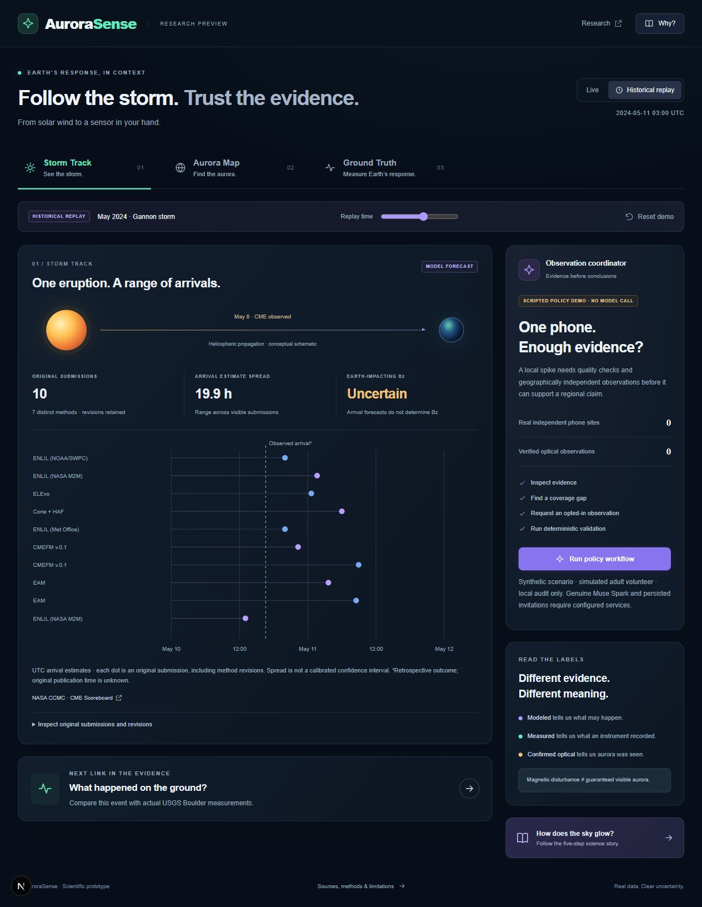

# AuroraSense

**See the storm. Find the aurora. Measure Earth's response.**

AuroraSense connects solar-storm forecasts, modeled auroral activity and ground magnetic measurements in an inspectable scientific workflow. Its research question is: **can quality-controlled smartphone magnetometers add useful independent information about regional geomagnetic disturbances?** An inconclusive answer is a valid result.

**Meta Global AI Developer Hackathon · Indie Developer track · proposed theme: Push the Frontier**  
Deadline: **November 4, 2026, 9:00 PM America/New_York** (November 5, 02:00 UTC).

**Status, October 28, 2026:** working local web demo, native acquisition, deterministic observation policy and reproducible offline experiments. The browser coordinator is **SCRIPTED POLICY DEMO — NO MODEL CALL**. **Actual Meta model use is a stage-one competition requirement; genuine Muse Spark execution remains a submission blocker.** Hosted backend validation is also outstanding. This repository does not claim submission completion or verified regional phone detection.



## Contents

- [Start the demo](#start-the-demo)
- [Test every screen](#test-every-screen)
- [Three-minute demonstration](#three-minute-demonstration)
- [What works and what remains](#what-works-and-what-remains)
- [Run the phone recorder](#run-the-phone-recorder)
- [Scientific results and reproduction](#scientific-results-and-reproduction)
- [Architecture and Meta integration](#architecture-and-meta-integration)
- [Verification and CI](#verification-and-ci)
- [Competition readiness](#competition-readiness)
- [Prepare a safe GitHub release](#prepare-a-safe-github-release)
- [Sources, licenses and documentation](#sources-licenses-and-documentation)
- [Troubleshooting](#troubleshooting)

## Start the demo

### Requirements

- Node.js **24**, npm and a modern browser. Git for cloning/release review.
- Python **3.12** for scientific tests/experiments; the measured local environment used 3.12.10.
- A physical magnetometer-equipped Android or iPhone with an Expo SDK 58 compatible client for native acquisition.

Python, a phone and cloud credentials are optional for the saved web demo. Download/clone this repository, open a terminal in its root, then run these commands individually, stopping if one fails:

```sh
npm ci
npm run build
npm run start --workspace @aurorasense/web
```

Open **[http://127.0.0.1:3000](http://127.0.0.1:3000)**. Keep the terminal running; Ctrl+C stops it. For development, use `npm run dev` instead of build/start. The server binds to loopback on this computer.

**No environment file or account is needed for the local demo.** After installing dependencies, saved replay, local QC, policy replay, source inspection and learning results work without upstream API access. **Refresh NOAA** is an optional network operation. Live mode initially displays the saved snapshot with its original timestamps; “Live” does not guarantee a fresh feed.

There is no public deployment or submitted demo-video URL in this version. GitHub provides the source and instructions; it does not automatically host the Next.js app. GitHub Pages cannot run its server routes.

## Test every screen

Use the production build above for rehearsal. Start around 1280 px wide, then repeat at **390 × 844** using browser responsive tools. Mobile browser layout testing does not exercise native sensors.

### A. Storm Track and shared clock

1. Start on **Storm Track → Historical replay**, initially **2024-05-11 03:00 UTC**.
2. Confirm **10 original submissions**, **7 distinct methods** and a **19.9 h** arrival-estimate spread. Open **Inspect original submissions and revisions**; each row has method, submitted UTC and arrival-estimate UTC.
3. Move **Replay time** toward the start, then forward. Rows appear according to submission time. This is an arrival ensemble; spread is not a calibrated confidence interval.
4. Switch tabs and verify the shared replay time. **Reset demo** restores the initial event/time, Storm Track, northern hemisphere, twilight shading and cleared scripted result.
5. Select **Live**. Inspect NOAA IMF **Bz in GSM/nT**, solar-wind speed in km/s and product times. If online, click **Refresh NOAA**. Success, partial failure or retained stale snapshot must be visible.

CCMC submission time is an availability proxy; independently archived page vintages are unverified. Observed arrival is a retrospective outcome with unknown original publication availability. Revisions are retained; later 2025 aggregate rows are excluded.

### B. Aurora Map

1. In **Historical replay**, select **Aurora Map**. Expect the historical model layer to be **unavailable**: no verified 2024 OVATION grid is loaded.
2. Select **Live**. Inspect the saved/latest NOAA OVATION grid, valid time, input observation time and freshness.
3. Toggle **Northern / Southern**, **Twilight shading** and **Coarse viewing region**. Verify the map renders the chosen regional target pin (Boulder, Fairbanks, Tromsø, or Hobart) alongside calculated Sun elevation and darkness.
4. Read the distinct modeled, ground magnetic and independently confirmed optical layers. **NONE LOADED** sightings and **Unknown** clouds are expected.

The map uses a geographic polar graticule and approximate geometric darkness. Validated magnetic coordinates, clouds, optical confirmations and local visibility probabilities are not implemented. Current NOAA data must never be relabeled as a 2024 forecast.

### C. Ground Truth with the portable sample

1. Select **Historical replay → Ground Truth**. The professional reference is genuine adjusted **USGS BOU F**, one-minute cadence, in **nT**. Original operational availability is unknown.
2. Click **Prepare a 10-minute observation**, inspect native acquisition instructions, then close the panel.
3. Click **Import sensor JSON** and choose:

   ```text
   demo/fixtures/synthetic-phone-local-interference.json
   ```

4. Confirm **SYNTHETIC** provenance, DEVICE-frame X/Y/Z in **µT**, scalar deviation, approximately **10 Hz** cadence and QC flags. The fixture has **1,601 samples over 160 seconds**, a fixed 120-second baseline, generated 12 µT interference at 135–140 seconds and rotation at 145–148 seconds. Expect local-interference rejection and an inconclusive regional interpretation.
5. Hover or touch-drag across the time-series trace: verify the interactive crosshair hairline, highlighted sample point, and tooltip badge displaying UTC time and amplitude. High-water cards must show **partial** usable coverage, never an invented multi-hour history. Flagged samples do not enter usable statistics.
6. **Forget imported session** removes the trace. Reimport and **Reset demo**: import and prior audit intentionally remain until Forget/reload. Reload starts a new in-memory session.

**This sample is mathematically generated, not historical phone evidence or measured sensor noise.** See [fixture documentation](demo/fixtures/SYNTHETIC_PHONE_FIXTURE.md). Phone and historical observatory traces are different periods, not a demonstrated correlation.

For an actual private recording, select its **raw session JSON**, not `-qc.json`. Processing stays in browser component memory, with no upload and an 8 MB bound. File declarations alone cannot establish physical hardware authenticity.

Negative test: save `{}` as a temporary JSON file outside the repository and import it. Expect a visible validation error, with no fabricated measurement. A separate QC-report JSON must also fail. A failed import should preserve any previous valid session.

### D. Coordinator and audit

1. Click **Run policy workflow**; keep **SCRIPTED POLICY DEMO · NO MODEL CALL** visible.
2. Inspect local-spike rejection, missing coverage, a simulated request to an already opted-in adult, follow-up checks and the final **INCONCLUSIVE** report.
3. Expand **audited tool actions**; **Export workflow evidence** downloads mode, evidence and actions as JSON.
4. **Replay policy workflow** repeats canonical results. Actual browser audit timestamps vary. No real person is contacted or sensor remotely started.
5. Open **Research → Demo audit**. Inspect navigation/import/reset/workflow actions. **Export audit** and **Export sources** download JSON. Reset preserves the audit; export before reload/close.

Local import and policy replay are separate workflows. Importing a real file does not silently add it to the simulated coordinator dataset.

### E. Why? and Research

1. Open **Why?**. Use numbered controls or **Next step / Previous** through solar disturbance, dayside reconnection, magnetotail energy transfer, particle precipitation and atmospheric emissions.
2. Verify scientific source links and the distinction between magnetic measurements and visible light. Return through **Back to the evidence**, Escape or **Close panel**.
3. Open **Research**; inspect measured learning scores, model MAE comparison bar charts (contrasting persistence, coupling baselines, and candidate), exclusions, manifests/checksums, limitations and the audit.
4. Repeat at phone width. Check tabs, map controls, import, modal close, tables and downloads. Test keyboard Tab/Enter/Escape.

### F. Backend failure behavior

Without configured cloud credentials, the actual route must fail closed. In a second terminal:

```sh
curl -i -X POST http://127.0.0.1:3000/api/agent -H "Content-Type: application/json" -d "{}"
```

On Windows use `curl.exe` if `curl` is a PowerShell alias. Expect **503 / AGENT_NOT_CONFIGURED**, with no model call. Credentials alone do not complete ingestion, authorization or invitation delivery.

## Three-minute demonstration

**A three-minute demo video is required by the participant guide.** It must highlight only features/code/functionality built during the hackathon and clearly identify original contributions. The code and live product are also judging artifacts. Verify final upload/format fields in the portal before recording.

| Time | Show | Required evidence/caption |
|---|---|---|
| 0:00–0:20 | Real phone measurement and local-interference rejection | Actual footage/export; disclose stability failures. A synthetic sample cannot stand in for hardware. |
| 0:20–0:45 | NASA ensemble and replay revisions | Original submissions, source, UTC and uncertainty |
| 0:45–1:10 | Aurora Map and layers | Current modeled activity separated from measured/optical evidence; historical layer missing |
| 1:10–1:39 | Actual USGS BOU plus phone/synthetic trace | Units, frames and separate times; no invented synchronized correlation |
| 1:39–2:13 | Evidence gap → useful opt-in request → checks | Current UI is scripted; genuine Muse Spark tool execution remains required for the intended final demo |
| 2:13–2:40 | Verdict and held-out model comparison | INCONCLUSIVE is valid; include persistence and worse candidate MAE |
| 2:40–3:00 | Why? explanation | Reconnection, particles and light; phones do not directly measure those mechanisms |

[Detailed runbook](demo/recording/runbook.md). Rehearse repeatedly, export the audit and use only claims supported by the recorded run. **EZIE-Mag correlation testing is deferred**, not required to test these screens and not a measured achievement.

## What works and what remains

| Capability | Working now | Remaining validation/integration |
|---|---|---|
| Three screens, clock, Why?, Research | Local production build | Final device/accessibility rehearsal |
| NASA arrival ensemble | 10 original submissions / 7 methods | Publication vintages; presentation-notification review |
| NOAA activity/wind | Timestamped snapshots and bounded refresh | Managed polling; historical 2024 oval absent |
| Viewing context | Approximate darkness/coarse region | Clouds, magnetic coordinates, optical confirmations absent |
| Native acquisition | Consent/lifecycle/export/delete code; two inspected iPhone exports | Android hardware, guided cues, physical Stop/revocation/delete checks |
| Phone QC/import | Raw plots, deterministic QC and usable coverage | No calibrated noise floor or accepted quiet recording |
| Regional validator | Tested rejection/inconclusive paths | No verified independent real phone network or supported event |
| Agent | Seven tools, scripted replay, server adapter/auth tests | Genuine model run and useful real invitation/response loop |
| Supabase | Migrations, RLS/private-bucket policies, budget/journal adapters, pgTAP suite | Hosted execution, auth UX, trusted ingestion/delete, invitations and managed jobs |
| Learning | Reproducible retrospective professional-data comparison | Operational availability unknown; phone benefit untested |
| EZIE-Mag | Identification and setup/export research | Unit not running; paired measurements deferred |

## Run the phone recorder

The native app has a separate lockfile and is outside root npm workspaces. Install root dependencies first, then:

```sh
npm ci --prefix apps/mobile
npm start --prefix apps/mobile
```

Open Expo's QR/link in an **SDK 58 compatible** client on a physical phone, on a reachable local network. On iPhone, sign in to **Expo Go and Expo CLI with the same account**; use `npx expo login` from `apps/mobile` if needed. Enter credentials in Expo's official flow, never in an issue or chat. A tunnel is an optional exposure choice, not required for saved web replay.

Read/grant adult participation and recording consent. Place the phone screen-up on a stable nonmagnetic support. Keep it foreground and untouched for a quiet run. The fixed baseline is the first **120 seconds**; automatic completion is at ten minutes. Backgrounding, consent withdrawal or Stop cancels collection. Export raw JSON/QC locally, then import raw JSON in Ground Truth. Export before deleting local recovery checkpoints.

For a separate interference test, optional **guided visual cues** avoid marker taps. Manual touches have a fixed interaction context, never automatic QC exemption. Scheduled cues request actions; they do not prove those actions occurred. No GPS, vibration/audio stimulus, background recording or speech transcription is implemented. Avoid saturating the sensor and keep accessories away during quiet acquisition.

Read [the full physical protocol](docs/sensor-experiment.md). Emulators and bundle exports cannot establish sensor performance. The web computer's loopback address is not another phone's address; use Expo's supplied native connection for collection.

### Magnetic Audio Explorer (Educational Sonification Test Mode)

Before starting a scientific session, toggle **Magnetic Audio Explorer** in the mobile app. It synthesizes real-time magnetometer readings into sound across 6 frequency tiers (220 Hz calm baseline hum up to 1,320 Hz high-frequency warning):
- **Physical acoustic intuition:** Move your hand, tilt the phone, or bring a watch or cable near: hear how the tone spikes in pitch and tempo.
- **The scientific lesson:** Hand movements and nearby metal create **2,000–30,000 nT** of local noise, while a real solar-storm CME response at mid-latitudes produces only **50–500 nT**. Hearing this contrast immediately explains why the phone must be completely still on a nonmagnetic support during the 10-minute scientific recording.
- In the web app, test the same acoustic behavior in **Ground Truth → Prepare a 10-minute observation → Interactive Audio Simulator**.

**Actual iPhone 14 Pro Max evidence:** partial interference run, 3,042 samples / 304.844 s / 9.9756 Hz, stopped on backgrounding; stationary repeat, 5,987 samples / 600.032 s / 9.97614 Hz, automatic completion, no >0.5 s gaps. Both failed unchanged scientific QC. The second baseline MAD was **801 nT** against the initial **250 nT** engineering gate, with exploratory endpoint change around **−9,096 nT**. Neither establishes intrinsic noise, storm detection or calibrated accuracy. Android hardware remains untested. [Measured report](docs/phone-experiment-2026-10-28.md).

## Scientific results and reproduction

### Python environment

Windows PowerShell, from the repository root:

```powershell
py -3.12 -m venv .venv
.\.venv\Scripts\python.exe -m pip install -r science/requirements.txt
.\.venv\Scripts\python.exe -m unittest discover -s science/tests -v
.\.venv\Scripts\python.exe -m science.experiments.learn --offline
```

macOS/Linux:

```sh
python3.12 -m venv .venv
.venv/bin/python -m pip install -r science/requirements.txt
.venv/bin/python -m unittest discover -s science/tests -v
.venv/bin/python -m science.experiments.learn --offline
```

Use that environment's Python below. Activation/PowerShell execution-policy changes are unnecessary.

### Frozen forecasting comparison

Historical NASA OMNI inputs and independently measured USGS BOU X targets support a compact model comparison. Target: mean response in **[t+30, t+35] minutes relative to the preceding one-hour median**. Three 2023 training blocks and two held-out 2024 blocks have a minimum 24-hour embargo. Normalization/fitting uses training data only; features exclude future target data.

| Model | Held-out MAE, nT | Held-out RMSE, nT |
|---|---:|---:|
| Persistence | 29.09 | 61.38 |
| Simple southward-coupling ridge baseline | 32.82 | 64.45 |
| Instantaneous + prior ground ridge | 29.08 | 58.12 |
| History + prior ground candidate | 29.48 | 58.69 |

**2,191 training / 851 test complete cases.** Only 370/846 quiet and 481/846 storm candidates survive missing inputs. History has worse MAE than persistence and worse MAE/RMSE than the instantaneous candidate. No universal ML improvement is claimed.

These are **conditional retrospective scores**. OMNI is retrospectively time-shifted; original operational availability remains unknown. No phone inputs or phone forecast benefit were evaluated. `--offline` reproduces saved scores using committed, source-hashed derived cases, without raw downloads or private phone files.

[Methods](docs/science-methods.md) · [results/exclusions](docs/evaluation-results.md) · [frozen protocol](science/experiments/learning_protocol.json) · [derived cases](science/results/learning_cases.json) · [model parameters](science/results/model_parameters.json).

### Exploratory AI filtering

A separate local Gaussian-process analysis uses all finite phone samples regardless of QC while retaining original flags/verdict. It is retrospective/noncausal, not Meta inference or scientific acceptance.

One-second difference MAD was 102.9 nT raw, 10.0 nT for a 15-second median and 28.5 nT for GP smooth. Across **432 synthetic injections of actual historical USGS BOU F shapes**, median retained amplitude was 99.961% for GP smooth and only 0.039% after subtracting it. Flattening the residual can erase the desired signal. These are filter-transmission tests, not validated recovery from actual phone noise.

Code/protocol/tests are public; the actual raw phone files/curves remain private. Reproducing that measured run requires the original hash-matched files, **not supplied by a public clone**:

```sh
python -m science.experiments.inspect_phone RAW_SESSION.json QC_REPORT.json
python -m science.experiments.phone_denoising RAW_SESSION.json QC_REPORT.json
```

Outputs stay under ignored `data/private/`. See [the executed filtering study](docs/ai-phone-filtering.md) for exact commands, optional `--plot` dependencies and limitations. Paired references and held-out physical runs are needed for source-aware correction.

### Optional source acquisition

These networked research commands are separate from offline judging:

```sh
python -m science.acquisition.sources
python -m science.experiments.inspect_broomfield
python -m science.experiments.learn
```

Bounded/checksummed raw responses go to ignored `data/raw/`. Respect rates; use acquisition `--refresh` only deliberately. Broomfield's checksum and CC BY 4.0 metadata were verified, with May 2024 overlap, but missing device/calibration/stationarity metadata means **NO-GO for a validated historical phone-storm claim**. Raw archive positions are private; only aggregate inspection outputs are distributed.

### Interpretation invariants

- Phone axes are **DEVICE-frame µT**; **1 µT = 1,000 nT**. Compare compatible scalar quantities/UTC bins, not phone X with geographic station X.
- Keep measurement, issuance, validity, availability and retrieval times distinct. Unknown availability is never assumed operational.
- QC is an engineering screen, not universal sensor sensitivity. Movement, nearby magnetic objects, device state and drift can confound readings; smoothing does not identify a cause.
- Regional support needs temporal alignment, independent sites/environments and matching professional references. One phone, household pair or simulation cannot establish it.
- The deterministic validator owns **SUPPORTED / INCONCLUSIVE / REJECTED**. LLM prose cannot override it. Magnetic support never guarantees visible aurora.

## Architecture and Meta integration

```text
Next.js / TypeScript ── NASA / NOAA / USGS saved fixtures
       │                bounded optional NOAA refresh
       ├── local phone import → deterministic QC
       ├── scripted policy replay → audit / canonical verdict
       └── authenticated /api/agent → bounded Muse Spark 1.3 adapter
                                      │ seven authorized tools
                                      └ Supabase Auth / RLS / budgets / journal
Expo foreground recorder → local raw / QC / CSV export
Python → acquisition / signal research / event-blocked learning
GitHub Actions → bounded tests, builds and offline experiments
```

One repository: Next.js intended for Vercel, Expo Android/iOS, Supabase managed persistence/jobs and Python science. No IaaS, Kubernetes, persistent GPU, background acquisition or voice reporting.

### Seven scientific tools

| Tool | Responsibility |
|---|---|
| `get_event_context` | Sourced event context/constraints |
| `get_regional_coverage` | Independent-site coverage in authorized cell/time |
| `get_reference_magnetometers` | Compatible professional references |
| `run_local_qc` | Trusted acquisition-quality results |
| `run_regional_coherence` | Deterministic alignment, coherence and verdict |
| `request_opt_in_session` | Bounded request to an eligible already opted-in adult |
| `publish_evidence_report` | Canonical report from the current assessment |

The intended real agent inspects evidence, identifies gaps, requests useful observations, invokes QC/coherence and reports its conclusion. Tools enforce server-derived identities/roles, strict schemas, consent, cell scope, rate/budget limits and append-only actions. Invitations never activate sensors remotely. Narrative cannot override scientific validation.

### Unfinished cloud integration

The saved demo needs **none** of these `.env.example` variables:

| Variable | Use |
|---|---|
| `META_MODEL_API_KEY` | Server-only Muse Spark 1.3 Responses calls |
| `NEXT_PUBLIC_SUPABASE_URL` | Supabase project URL |
| `NEXT_PUBLIC_SUPABASE_PUBLISHABLE_KEY` | Publishable key; RLS still required |
| `SUPABASE_SECRET_KEY` | Server-only trusted persistence/budget/journal |

For an authorized test project, copy `env.local.example` (or `apps/web/.env.local.example`) into `apps/web/.env.local`, enter values matching the documented key format and restart. Never prefix secrets with `NEXT_PUBLIC_` or put them in Git/screenshots/prompts. `apps/web/.env.local` remains securely excluded by `.gitignore`.

The real route accepts only `eventId` with a Supabase Bearer token, verifies administrator-controlled researcher/cell metadata and adult consent, then loads trusted persisted summaries. Auth UX and end-to-end phone ingestion are absent. All three migrations and pgTAP tests are supplied, **not executed against a hosted database**. Missing config fails 503, unauthorized access fails, missing ingestion fails 409. Real invitation delivery remains deliberately blocked.

Before claiming a live agent: apply/test migrations in an authorized isolated Supabase project; verify actual-role RLS and private upload/delete; implement trusted summary ingestion and transactional invitation/acceptance; execute a bounded real Meta run; inspect usage/tool choices/persisted audit. `store:false` is not a zero-retention guarantee. Mock tests are not provider validation. [Full backend contracts/budgets/gates](docs/agent-backend.md).

## Verification and CI

Run from root, stopping on a failed command:

```sh
npm run typecheck
npm run lint
npm test
npm run build
npm run typecheck --prefix apps/mobile
```

Run Python tests/offline learning with the environment above. Native JavaScript bundle checks:

```sh
cd apps/mobile
npx expo install --check
npx expo export --platform android --output-dir dist-android
npx expo export --platform ios --output-dir dist-ios
```

Exports compile JavaScript/assets, not signed installable releases or sensor hardware. Root `lint` covers web/packages; mobile source was separately linted with the root ESLint installation.

**October 28 local results:** root/workspace type checks, lint, **82 TypeScript tests**, Next production build, mobile type check, **28 Python tests** and exact offline score reproduction passed. Android/iOS bundles and Expo compatibility passed earlier the same day. [Production UI acceptance record](docs/ui-acceptance-2026-10-28.md) and [progress](docs/progress.md) record rendered checks and their scope.

Tests cover malformed/missing data, units/time, contamination, cancellation, interaction annotations, co-location/alignment, leakage, forbidden tools, auth boundaries, bounded transports, source ownership, redaction and deterministic replay. SQL text/mocks do not prove hosted RLS. Physical, hosted and actual-provider validation remain distinct.

[Managed CI](.github/workflows/verify.yml) has bounded web/policy, science/offline and mobile jobs without model calls. **Remote CI has not run until a push and successful Actions execution.** Eight previously observed Expo development-tool audit findings (three high/five low) remain; no compatible SDK-preserving fix was established. Reassess advisories before release; compilation is not a security review.

## Competition readiness

Checked **October 28, 2026** against the [official event page](https://cerebralvalley.ai/e/meta-ai-developer-hackathon), [Participant Guide](https://cerebralvalley.ai/e/meta-ai-developer-hackathon/details) supplied by the owner, and [Official Rules / Event Waiver](https://cerebralvalley.ai/e/meta-ai-developer-hackathon/waiver). Track: **Indie Developer**, selected by the owner. Suggested theme: **Push the Frontier**, through physical sensing/scientific experimentation.

Official scoring: **Impact 30%, Meta AI tooling 25%, Technical depth/execution 20%, Demo 25%**. A submission enters one track; Indie teams may have up to four members through a representative. Accepted participation, adulthood and residence/affiliation eligibility must be verified. Originality and third-party rights must be established. Entrants retain IP while granting organizers broad submission/material-use rights. Read the full terms before submitting; this README accepts nothing for the entrant. [Official rules](https://cerebralvalley.ai/e/meta-ai-developer-hackathon/waiver).

| Readiness item | Evidence / required action |
|---|---|
| Indie entry | Owner selected; one project in one track, one team submission; match portal |
| Open source | **Public repository required** by the guide; review private files before publishing |
| New work / originality | [Contribution record](docs/hackathon-contributions.md) identifies implementation versus pre-existing inputs. Owner verifies it; unclear attribution can disqualify the entry |
| Impact | Explain intended users, trustworthy regional evidence and sensing limits |
| Meta tooling / stage-one gate | Guide requires reasonable actual use of Meta Model API and/or Meta open weights. Adapter/tools alone do not establish this. **A genuine Muse Spark run is a submission blocker** |
| Technical execution | Real acquisition, local tests/builds, manifests, frozen evaluation/audit |
| Demo / new work | **Three-minute video required**, showing only hackathon-built work and clearly identifying original contributions. Local tour works; final footage/video/link verification remains |
| Eligibility/acceptance/terms | Owner verifies selected-participant status, restrictions and accepted terms; code cannot establish these |
| Team/authorship | Enter actual members/representative and accurate AI-assistance disclosure; coding agents are not human entrants |
| Rights/privacy | MIT original code, separate data notices, private raw/location exclusions; finish CCMC presentation-notification and attribution review |
| Submission | Owner completes portal before deadline and retains receipt |

Use the [official submission portal](https://cerebralvalley.ai/e/meta-ai-developer-hackathon/hackathon/submit) by November 4, 9 PM ET; late submissions are excluded. The guide requires a publicly accessible repository, accessible three-minute video and all contributors listed. Stage one checks theme fit and Meta model use; later judging uses the rubric above, with the top five per track advancing. Final form/upload fields and live-product access details remain unverified in the unauthenticated portal view. Recheck organizer updates before submission. [Participant guide](https://cerebralvalley.ai/e/meta-ai-developer-hackathon/details).

The guide describes API credits and payment-method prerequisites. Any credit claim, billing setup or paid API authorization is an owner action; none was performed here. The approved product excludes voice transcription even though the event lists that model among its resources.

Do not submit confidential material: official terms grant broad rights to materials. No agreement was signed, entry submitted or external notification sent in this implementation session.

## Prepare a safe GitHub release

Ignored: credentials (`.env*` except `.env.example`), dependencies/builds, `data/raw/`, `data/private/`, `science/private/`, local phone-export filename patterns and project-pack ZIPs. **Ignore rules do not remove tracked files and are not a complete secret scanner.** Put all future personal recordings under `data/private/`, regardless of filename.

Before staging:

```sh
git status --short --untracked-files=all
git ls-files
git ls-files --others --exclude-standard
git check-ignore data/private/release-probe.json data/raw/release-probe.json apps/web/.env.local phone-example-json.json
git add --dry-run .
```

All four probes should be ignored; they need not exist. Inspect candidates for secrets, private recordings, precise volunteer/EZIE positions, identity-bearing screenshots, unlicensed media, Broomfield raw data and cached third-party PDFs. Do not ZIP the entire working folder: ZIP tools can include ignored files. Publish reviewed Git contents/a reviewed release archive.

After that review:

```sh
git add .
git diff --cached --stat
git diff --cached --check
git diff --cached --name-only
```

Review actual staged contents and run a suitable secret scanner. Unstage private files before proceeding. `.env.example` must have empty credential values. Include root/mobile lockfiles, tests, public fixtures, source notices and result manifests. Then commit locally:

```sh
git commit -m "Add AuroraSense scientific demo"
```

Create the intended GitHub repository in your account, choose **public** visibility as required by the participant guide and use GitHub's displayed remote/push commands. No owner/remote URL is assumed here. Review all three Actions jobs, test a fresh clone and verify judge links from a separate browser/session before final submission. A local build does not mean remote CI passed.

No GitHub repository, remote, public deployment, purchase or irreversible account change has been created by this task. A later Vercel deployment requires separate review of monorepo/file-tracing configuration and server secrets, and owner authorization.

## Sources, licenses and documentation

Original code: [MIT](LICENSE). External data/dependencies retain their own terms; MIT does not license all linked data/agency marks. Credit **NASA CCMC and forecast teams, NASA GSFC/SPDF OMNIWeb and instrument teams, NOAA SWPC, USGS BOU and C L Stanton's Broomfield archive** as applicable. No agency endorsement is claimed.

Source URLs, upstream checksums, retrieval times, units, quality and time semantics accompany fixtures. Private/restricted raw records stay excluded. The sample phone file is synthetic. The approved AI-generated wireframe has fictional readings and is a design reference only.

| Path | Purpose |
|---|---|
| `apps/web/` | Next.js UI, local import, NOAA/agent routes |
| `apps/mobile/` | Expo foreground recorder |
| `packages/shared/` | Sensor contracts, lifecycle, QC, interaction protocol |
| `packages/coordinator/` | Seven tools, authorization, validator, adapters |
| `science/` | Acquisition, frozen experiments/tests, sanitized results |
| `supabase/` | Migrations and unexecuted hosted-access tests |
| `demo/fixtures/` | Sourced replay and labeled generated input |
| `docs/` | Methods, evidence, progress, screenshots |
| `.github/workflows/` | Bounded managed verification |

Authoritative scope: [goal.md](goal.md), [assets.md](assets.md), [plan.md](plan.md), [AGENTS.md](AGENTS.md). More: [rights/provenance](docs/provenance-rights.md), [third-party notices](THIRD_PARTY_NOTICES.md), [backend](docs/agent-backend.md), [sensor protocol](docs/sensor-experiment.md), [progress](docs/progress.md).

## Troubleshooting

| Symptom | Action |
|---|---|
| Missing modules | Root `npm ci`; mobile also needs `npm ci --prefix apps/mobile`. Keep both lockfiles. |
| Port 3000 occupied | Stop the other server or use `npm run start --workspace @aurorasense/web -- --port 3001` and open that port. |
| Missing production build | Run `npm run build` before start; use `npm run dev` for development. |
| Phone cannot reach computer | Expo connection, reachable LAN, appropriate local-network permissions. Phone loopback is its own device. |
| Expo Go sign-in error | Match Expo Go/CLI accounts on iPhone and use an SDK-compatible client. |
| Recording stops on call/app switch | Non-active AppState stops capture. Preserve partial run; begin anew, never splice away a gap. |
| Import fails | Raw session JSON, not QC report; check 8 MB bound and try the synthetic fixture. |
| QC rejects all samples | Inspect raw flags/context; retain failure. Filtering cannot certify a regional event. |
| Missing 2024 oval/clouds/sightings | Expected missing evidence; it is not fabricated. |
| NOAA refresh fails | Read error/stale timestamps; saved replay remains usable. |
| Server warns a NOAA response exceeds the 2 MB Next fetch-cache limit | Resolved: the ~3.17 MB wind payload upstream fetch now specifies `cache: 'no-store'`, eliminating Next.js fetch-cache size warnings while preserving downstream `s-maxage=300` CDN caching. |
| Agent 503/409 | Config/trusted ingestion absent; follow integration gates, not a mislabeled mock. |
| Scores differ | Python 3.12/pinned requirements, root directory, `--offline`; inspect checksums and counts. |

Report issues with screen/action, expected/actual result, OS/browser, command and redacted error. Keep credentials, personal recordings and locations out of public issues.
