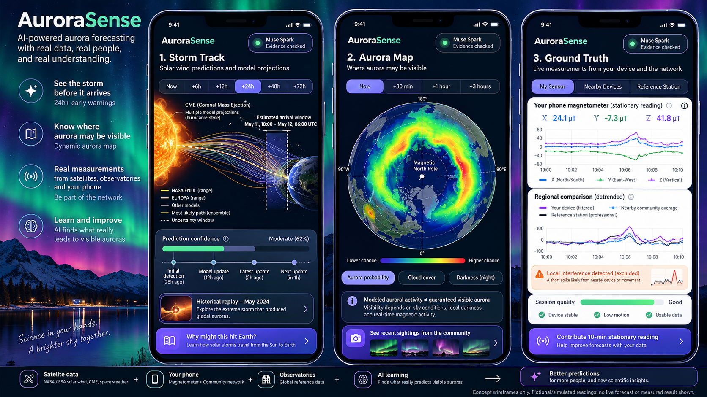

# AuroraSense — Project Goal and Product Contract

> **Status:** Hackathon product goal / design contract, not a claim of implemented functionality.  
> **As of:** October 28, 2026. **Submission:** November 4, 2026, 9:00 p.m. Eastern (America/New_York).  
> **Hackathon:** Meta Global AI Developer Hackathon — **Push the Frontier** theme.  
> **Companion specifications:** [`assets.md`](assets.md) (source and rights inventory) and [`plan.md`](plan.md) (engineering, research, acceptance tests, three-minute voiceover).  
> **Constraint:** No user-managed IaaS; Meta models + Vercel + Supabase + managed build/testing services only. New, rights-cleared code and data in a public repository.

## 1. Mission

**AuroraSense: See the storm. Find the aurora. Measure Earth's response.**

Create an accessible, scientifically honest aurora early-warning and discovery application that combines:

1. **Incoming space-weather forecasts:** Solar eruptions, coronal mass ejection (CME) arrival ensembles, upstream solar wind and interplanetary magnetic field (IMF) measurements.
2. **Regional aurora forecasting:** NOAA's auroral oval, geomagnetic latitude and local-time dependence, nighttime/cloud viewing conditions, and a small learned forecasting model evaluated against independent historical observations.
3. **Actual ground and optical evidence:** Professional magnetometers, opt-in smartphone magnetometers, auroral cameras, and crowdsourced sightings/photos.
4. **An agentic scientific coordinator:** Meta Muse Spark investigates discrepancies, notices missing independent evidence, requests targeted **opt-in** recordings, calls deterministic scientific validators and explains the bounded conclusion.
5. **A clear educational narrative:** Explain magnetic reconnection, magnetospheric energy storage/transport, auroral particle precipitation, and atmospheric light emission; let users trace the scientific evidence behind each alert.

**The signature question:** *Can quality-controlled smartphone magnetometer readings add useful, independent information to regional geomagnetic-disturbance detection and aurora nowcasting?* The first hackathon result must **measure** this possibility, not presume an affirmative result.

**The longer-term research question:** *Do the temporal structure and history of solar-wind/IMF driving, including IMF Bz persistence, reversals and pressure fluctuations, improve forecasts of independently observed ground magnetic response and optical aurora beyond established baselines?* This is motivated in part by Katariina Nykyri's May 2024 CME Kelvin–Helmholtz research (DOI: https://doi.org/10.1029/2024GL110477), but causal attribution to individual reconnection events is **not** claimed from ground measurements alone.

## 2. Visual product goal

**Wireframe provenance:** The image above is an AI-generated **conceptual mockup** produced during project planning. Every displayed number, confidence percentage, graph, phone location, forecast curve and timestamp in the image is illustrative. It must not be passed off as observed scientific data. The product implementation must use actual source provenance, scientifically grounded timestamps, and explicit labels for simulated material.

The application has **three primary tabs**, a shared **Live / Historical Replay** clock, and a contextual **Why?** educational panel. These remain the fundamental navigation contract.

### 2.1 Storm Track — “What's coming?”

- Hurricane-style **ensemble CME arrival-time** view: independently issued predictions, model names, issue times, estimated arrival windows, forecast revisions, and subsequent observed impact in replay.
- A Sun–Earth schematic may provide orientation, but the ensemble is an **arrival-time forecast**, not a fabricated family of literal CME trajectories.
- Separate forecast phases: **24–72+ h** optical/CME detection and heliospheric propagation; **near-Earth** L1 solar-wind/IMF and short-term geoeffectiveness.
- Observed CME launch, modeled impact likelihood, forecast uncertainty, real-time IMF Bz, solar-wind speed/density/pressure, and data freshness.
- If no archived forecast issuance is available, the UI must say *historical reconstruction*, never “what NOAA predicted at that time.”
- Explain that CME arrival time can be forecast days ahead, while the Earth-impacting internal field orientation (especially Bz) often remains uncertain before sampling near Earth.

### 2.2 Aurora Map — “Where might I see it?”

- Northern/southern polar or global map with **NOAA OVATION modeled auroral activity** and a clear forecast-valid time.
- User-selected coarse location; magnetic latitude/local time; night/twilight masks; conditional cloud/light-pollution overlays; optional confirmed sightings and coverage cells.
- Display three distinct evidence layers: **modeled activity**, **quality-checked ground magnetic disturbance**, and **direct optical sighting**.
- Only show numerical local visibility probability when a prediction has been **calibrated and evaluated** for that location and horizon; otherwise use qualitative categories with explicit uncertainty.
- Time slider only offers forecast horizons actually produced by the source/model; do not extrapolate a current OVATION grid to +72 h.
- Photos and sighting pins are private/provisional until appropriately reviewed and consented.

### 2.3 Ground Truth — “What does Earth measure?”

- **My sensor:** live phone magnetometer x/y/z **in device coordinates**, magnitude in μT, relative perturbation Δ|B| in nT, UTC timestamps, sample rate, motion stability, calibration/quality flags and start/stop/consent controls.
- **Professional references:** USGS/IMAGE/INTERMAGNET station traces with actual physical units and clearly identifiable provenance.
- **Community network:** opt-in observations aggregated into privacy-protecting geographic cells; show **independent usable sites**, not misleading raw phone totals.
- **High-water marks:** maximum/percentile perturbation over 1 h, 6 h and 24 h, but only for measured intervals and with the quality status shown.
- **Interference:** a nearby magnet, changing device orientation, magnetic accessory or indoor environment may produce a large false spike; a single device cannot establish a geographically coherent storm.
- **Evidence labels** fixed across all charts: `LIVE PHONE`, `ARCHIVED PHONE`, `HISTORICAL OBSERVATORY`, `MODEL FORECAST`, `HISTORICAL RECONSTRUCTION`, `SYNTHETIC PHONE SIMULATION`.
- Offer **Contribute a 10-minute stationary observation** only with express opt-in and a clear stop control.

### 2.4 Contextual education — “Why is this happening?”

A short, reviewed, interactive five-step story accessible from all three tabs:

1. Solar wind, high-speed streams and CMEs carry magnetic fields and plasma outward from the Sun.
2. Favorable IMF–magnetosphere geometry enables enhanced dayside magnetic reconnection and energy/magnetic-flux transfer.
3. Magnetotail storage and release, current systems and particle-acceleration processes contribute to magnetospheric/ionospheric response.
4. Energetic electrons precipitate along magnetic fields and collide with atmospheric oxygen/nitrogen.
5. Excited atmospheric species emit auroral light; visibility depends on emission altitude/intensity and local darkness, clouds and viewing geometry.

Separate **what is directly measured**, **what is modeled/inferred**, and **what remains scientifically unresolved**. Generated conceptual images are labeled diagrams, not spacecraft measurements. Provide a simple view for the public and expandable research notes, station/source references and definitions.

### 2.5 Research drawer (secondary view, not a fourth primary tab)

Accessible details: raw and filtered traces, quality masks, source IDs, issuance/availability times, geographic/geomagnetic coordinates, CME ensemble members, model versions, baseline scores, agent actions, exportable event window and method notes.

## 3. The scientific experiment that makes the demo credible

**Experiment A — Smartphone feasibility (P0):**

- Record genuine three-axis magnetic samples on at least **one physical phone**, stationary under stable conditions.
- Introduce a safe controlled **local magnetic interference**; detect and label it as local/unknown, not auroral evidence.
- Compare any verified overlapping archived phone series with a professional station. The publicly listed **Broomfield, Colorado 2023–2025 ZIP** is a *candidate only*: the file contents, actual dates, device identities, calibration, and license must be inspected before claiming storm detections.
- When an overlapping real phone storm recording is unavailable, replay **real professional observatory signals** plus separately labeled **synthetic phone noise derived from empirically recorded sensor noise**. This is simulation, not a historical smartphone observation.
- Measure detection/false alarm behavior, sample usability, temporal alignment, residual noise and whether additional **independent geographically separated sites** add evidence.

**Experiment B — Learning from solar-wind history (P0 small, long-term broad):**

- A modest reproducible model predicts a **regional ground magnetic disturbance threshold/amplitude 30–60 minutes ahead** from historical upstream solar wind and prior state available at the time.
- Benchmark against **persistence** and **simple physics-inspired coupling functions** (e.g., southward Bz/Newell-style features).
- Test whether **Bz reversals, persistence, variance, pressure pulses and driving history** add held-out skill.
- Report measured scores **even if the new model is worse**. Any learning claim is limited to evaluated target, horizon, region, and data split.
- **Optical auroral occurrence/visibility** is the next learning target using THEMIS all-sky labels, Aurorasaurus, MIRACLE, GOLD and DMSP data; do not train the MVP against Kp alone and call it verified aurora visibility.

**Forecast causality and latency:** Time-shifted OMNI inputs, final indices, corrected retrospective stations and later-submitted photographs can be valid analysis data while being unavailable to a real-time forecaster. Preserve `observed_at`, `issued_at`, `available_at`, and model `valid_at` in UTC. The demonstrator must not leak future observations into a past-time prediction.

## 4. The agentic Meta differentiator

One **Muse Spark 1.3 scientific observation coordinator**, using Meta Model API Responses/tool calling. No swarm of free-running chatbots. The model consumes compact **derived** scientific summaries, not giant raw sensor streams.

**Agent loop:**

1. Inspect event state, forecast discrepancies, ground-sensor QC, independent site coverage and uncertainty.
2. Identify a precise missing piece of evidence and why it matters.
3. Select a scientifically useful, **permitted** opt-in observation region/duration; send a volunteer invitation rather than remotely activating a sensor.
4. Await a real or clearly labeled simulated participant session; invoke deterministic QC and cross-site/observatory comparisons.
5. If the evidence changes, update the qualified conclusion; if insufficient, explicitly report `INCONCLUSIVE`.
6. Create a source-grounded public explanation and a reproducible scientific event note. The LLM **never** overrides numerical evidence or invents measurements.

Seven typed tools (specified in `plan.md`) support: `get_event_context`, `get_regional_coverage`, `get_reference_magnetometers`, `run_local_qc`, `run_regional_coherence`, `request_opt_in_session`, and `publish_evidence_report`.

**Not acceptable:** agent inventing an aurora observation, equating a single phone spike with a magnetic storm, activating sensors without consent, exposing private GPS, changing a locked prediction or detection threshold after seeing the answer, publishing a definitive regional detection despite `INCONCLUSIVE`, or inventing probability values.

## 5. Privacy, safety and data rights

- **Adults-only Meta-integrated MVP pending current Meta Model API age/targeting terms.** The general-public app cannot be assumed eligible for users under 18 without a suitable provider/permission pathway.
- Foreground sensor collection only for hackathon; no covert/background tracking. Explicit recording consent, user-visible stop button and export/delete controls.
- Default public map uses coarse cells, not exact volunteer home coordinates. Raw sessions and original photos are private; only aggregate/station data are public by default.
- Strip sensitive location-bearing EXIF from any publicly displayed copy; keep scientific capture metadata securely if consented; public image publication is a separate choice from scientific use.
- Supabase Auth, row-level security, short-lived signed uploads, size/rate limits, auditing and clear retention.
- External dataset access, redistribution, license, station attribution and photo rights are reviewed asset by asset. A public Zenodo listing is not a blanket redistribution license.
- Model API key remains server-side (Vercel/Supabase secrets). Use **Standard** model mode for participant information, not a mode allowing training use of submissions.

## 6. Hackathon acceptance: Must / Bonus / Future

| Priority | Feature / proof | Definition of done |
|---|---|---|
| **P0** | Three connected, polished screens | Shared Live/Replay time, honest source labels, responsive mobile web UI |
| **P0** | Storm Track | Actual archived NASA CCMC CME ensemble; live NOAA upstream status |
| **P0** | Aurora Map | Live NOAA OVATION; visibility caveat; replay clearly marked |
| **P0** | Ground Truth physical capture | At least one real phone; timestamps, units, stationary session and QC |
| **P0** | Artifact rejection | Local magnet spike flagged; no region-wide aurora claim |
| **P0** | Professional reference replay | Actual USGS or IMAGE historical station trace aligned to event |
| **P0** | Meta tool-using agent | Recorded real tool loop: gap → invitation → QC → evidence verdict |
| **P0** | Evidence semantics | `SUPPORTED / INCONCLUSIVE / REJECTED` from deterministic scientific validator |
| **P0** | Learned-vs-baseline evaluation | Reproducible small model and held-out comparison, whether better or worse |
| **P0** | Interactive Why panel | Scientifically reviewed explanation of reconnection and aurora formation |
| **P0** | Security/data provenance | Consent, RLS, access test, simulated data labeling, model/data source citations |
| **P1** | Android and iOS independently tested | Two real native clients; mark each tested platform accurately |
| **P1** | Archived phone storm comparison | Only if Broomfield or another archive has verified overlapping records |
| **P1** | Aurora-photo/sighting submission | Authenticated, opt-in, location privacy and provisional label |
| **P1** | Regional simulated network | Measured noise profiles, independent-site assumptions and ablation results |
| **P1** | Optical occurrence model | Appropriate confirmed positive and eligible negative labels, held-out split |
| **Bonus** | Muse Wonder research red-team | Challenges interpretation; cannot override tools |
| **Bonus** | Muse Spark image understanding | Candidate aurora/photo/cloud classification, human-validated |
| **Bonus** | Muse Image diagrams | Original labeled educational artwork |
| **Bonus** | SAM 3.1 segmentation experiment | Only if benchmark supports real aurora-feature utility |
| **Bonus** | Push alerts, cloud, sightings gallery | Only after P0 reliability and permissions |
| **Future** | Global always-on observing network | Prospective large-scale collection, calibration, consent, scientific validation |
| **Future** | Demonstrably improved 24–72 h aurora forecasts | Multi-year/prospective independent evaluation, not hackathon claim |

## 7. Deliberate non-goals

- No direct ambient electric-field measurement from stock phones; external hardware needed.
- No attempt to claim phones directly detect reconnection at the magnetopause. They measure local magnetic field and possible ground response.
- No continuous background phone measurement on iOS/Android during the hackathon.
- No assertion that **more phones always means better forecasts**; correlated local artifacts and uneven coverage can negate naive `1/sqrt(N)` gains.
- No promise to outperform NOAA OVATION, GFZ PAGER/auroral oval, DAGGER, GeoDGP or AuroraTonight without fair head-to-head tests.
- No fabrication of historical OVATION grid issuance, model confidence, geographical corroboration, measured forecast improvements or community sightings.
- No production-scale multi-decade training on a Vercel request or Supabase Edge Function.

## 8. Implementation boundaries and design choices

- **Frontend:** Vercel-hosted Next.js / TypeScript with accessible maps and scientific plots.
- **Sensor app:** Expo React Native, native magnetometer/IMU APIs, foreground recording, local QC and batched uploads; platform-specific availability tested on physical devices.
- **Backend:** Supabase managed PostgreSQL, Auth, RLS, private Storage, Edge Functions, Cron. Scientific numerical work in managed hosted CI or short serverless tasks, not IaaS.
- **AI:** Meta Model API, primarily `muse-spark-1.3` Responses, bounded tool loops; Wonder/image/segmentation selectively; no AI inference in the high-rate numeric sensor path.
- **Single repository:** web, mobile, shared types, science, Supabase, demo fixtures and documentation. No Kubernetes, VM, Redis requirement, custom vector DB or full multi-agent framework.
- **Cost:** $150 Meta Model API credits for measured usage with application-level request/token budget and buffer. Vercel/Supabase/Expo/maps/CI may have separate limits or fees.

## 9. Story the judges must see

**Cold open:** one physical phone spikes near a magnet; the app refuses to classify it as regional space weather. **Storm Track:** historical CME forecast ensemble with issued-at times. **Aurora Map:** current modeled oval and clearly labeled historical observations. **Ground Truth:** reference storm trace, actual phone QC and any explicitly synthetic regional replay. **Meta acts:** the agent detects an evidence gap, invites an opted-in follow-up, rechecks scientific tools and publishes a bounded conclusion. **Research proof:** measured baseline comparison. **Education:** Why? explains reconnection and how atmospheric aurora is born.

See `plan.md` for the precise three-minute shot list and voiceover. Record only behaviors that actually pass the listed tests. The central achievement is **verifiable scientific autonomy**, not a visually impressive but invented forecast.

## 10. Source and originality statement

This project builds on established published work (NOAA OVATION, NASA/CCMC and OMNI, professional observatories, CrowdMag, Aurorasaurus, THEMIS optical classifications, NASA DAGGER, Michigan GeoDGP/AuroraTonight, GFZ products, and Nykyri's CME studies). Their previous existence is credited in `assets.md`.

**New hackathon work** must be independently identifiable in the repository: the three-screen integrated interface, live phone sensor collector, QC/coherence engine, provenance-aware scientific replay, measured learning experiment, typed Meta observation coordinator, secure consent flow and execution/evaluation harness. No confidential data or unlicensed code/media are to be published.

**Decision record:** This is the AuroraSense branch of the broader brainstorming work, not TeenDrive or HomeFlow. The product and hackathon artifacts should stay focused on AuroraSense only.
