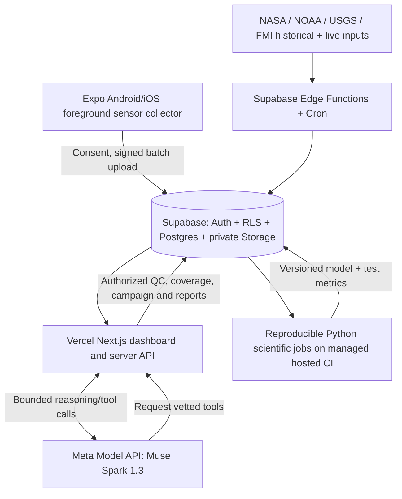

# AuroraSense — Demo-First Build and Research Execution Plan

> **Status:** Implementation plan, not completed work.  
> **Created:** October 28, 2026. **Submission:** November 4, 2026, **9:00 p.m. ET** (EST on that date; America/New_York).  
> **Read first:** [`goal.md`](goal.md) defines the product contract; [`assets.md`](assets.md) is the canonical inventory of sources, software, model references and media rights.  
> **Project strategy:** Build from the three-minute judged video backwards. One polished three-screen product, one validated physical-sensor experiment, one small reproducible scientific model, one genuine Muse Spark tool-use loop. **No user-managed IaaS.**

## 0. Decision summary and scientific honesty contract

**Project:** AuroraSense — *See the storm. Find the aurora. Measure Earth's response.*  
**Hackathon track/theme:** Indie Developer if solo; Push the Frontier.  
**Primary innovation:** Meta-powered autonomous observation coordination over real scientific evidence and physical phone sensors.  
**Main hypothesis:** A quality-controlled, spatially distributed smartphone magnetometer network may help detect and characterize sufficiently strong regional geomagnetic disturbances. Its incremental forecasting value **has to be measured**.  
**Additional learning hypothesis:** Temporal structure of solar-wind/IMF inputs may add predictive information for regional ground magnetic response and actual optical aurora beyond established coupling and persistence baselines.

**Always distinguish:**

| Category | Meaning | Example |
|---|---|---|
| `MEASURED_LIVE` | Actually recorded in current physical session | One Android device on a table |
| `MEASURED_ARCHIVAL` | Historical authentic instrument observations | USGS Boulder during May 2024 |
| `ISSUED_FORECAST` | Forecast made/issued before actual target time | A CCMC CME arrival estimate with original issuance |
| `RETROSPECTIVE_RECONSTRUCTION` | Model or plot calculated after observing the event | Reconstructed auroral map for May 2024 |
| `SYNTHETIC` | Generated data with explicit simulation assumptions | BOU storm curve plus sampled phone-noise process |
| `ML_PREDICTION` | Model output with version, valid time and inputs | Held-out regional ΔB exceedance probability |

A real phone measured **today** is not a phone that measured the historical 2024 storm. An ML-generated probability is not empirical observation. A magnetometer spike is not proof of aurora. An LLM explanation is not an independent physical measurement. These rules apply to every chart, caption, alert, API response and spoken demo line.

---

## 1. Design the judged demo before implementing the backend

### 1.1 Central three-minute story

**Story question:** *“My phone detects a magnetic spike. Is Earth reacting to the solar wind — or did I move it near a magnet?”*

Our system answers it by combining an **as-issued** historical CME ensemble, NOAA auroral model, genuine professional magnetometer storm records, real foreground phone sampling and deterministic regional-quality tests. The scientific agent identifies an observation gap and **asks for a useful new measurement**, rather than inventing a storm alert.

**Why this judges well:** One physical-sensor moment; a visual Sun-to-Earth forecast; a beautiful aurora map; a meaningful scientific contradiction; a real AI tool-using agent; a reproducible result with uncertainty; a short explanation of reconnection and atmospheric aurora.

### 1.2 Exact shot list and must-work proof

| Time | Visual | Action on screen | Actual implementation obligation |
|---|---|---|---|
| **0:00–0:20** | Ground Truth, live phone | Phone on table; a magnet or magnetic accessory approaches; field trace spikes; “Possible local interference — not regional confirmation” | **Real hardware** sensor event; QC; no regional alert |
| **0:20–0:45** | Storm Track, May 2024 replay | Multiple historically issued CME ETA predictions, model/source names, uncertainty in timing | NASA CCMC records, issue times, source links; no invented forecasts |
| **0:45–1:10** | Aurora Map | Polar auroral oval, nighttime mask, archival sighting/reference overlays | Real NOAA live mode or honestly labeled historical reconstruction; optics distinguished |
| **1:10–1:39** | Ground Truth | Phone raw/filtered trace, USGS/IMAGE archival field, site coverage, quality flags | Real current phone + real historical station + synthetic overlays only if clearly flagged |
| **1:39–2:13** | Agent activity drawer | Spark inspects QC+coverage, asks for remote opt-in 10-minute session, receives completion summary, invokes validation again | **Actual model tool loop** and persisted campaign; simulated participant explicitly marked if used |
| **2:13–2:40** | Scientific verdict + research drawer | Supported/inconclusive/rejected evidence, baseline vs learned model scores, provenance | Real executed deterministic validator; measured held-out metrics if available |
| **2:40–3:00** | Why panel / closing | Solar wind → reconnection → currents/precipitation → oxygen/nitrogen aurora | Reviewed educational content, source labels and accurate wording |

**Recorder rule:** Use a short accelerated demo clock only for waiting. Label it `DEMO REPLAY`, not real elapsed time. Avoid dependence on a live solar storm, live remote volunteer, public app-store approval or external reviewer account.

### 1.3 Final voiceover draft (target approximately three minutes)

> **0:00–0:20 — Cold open**  
> “This phone just measured a magnetic spike. Does that mean an aurora is coming? No. A nearby magnet can do the same thing. AuroraSense is designed to distinguish local interference from evidence of a real space-weather response.”
>
> **0:20–0:45 — Storm Track**  
> “Storm Track combines published solar eruptions with multiple CME arrival predictions. Like a hurricane ensemble, the models disagree, and the estimated arrival window changes as new information comes in. We're replaying the May 2024 superstorm. Arrival-time forecasts don't tell us the CME's final Earth-impacting magnetic orientation.”
>
> **0:45–1:10 — Aurora Map**  
> “Aurora Map separates predicted auroral activity from observed sightings, then shows darkness and other local viewing conditions. The map answers where to look, but it never mistakes a magnetic storm for a guaranteed visible aurora.”
>
> **1:10–1:39 — Ground Truth**  
> “Ground Truth collects real three-axis phone magnetometer measurements and evaluates stability, timing and local interference. We compare those sessions with professional observatory data from the 2024 event. Where we test larger networks using simulated phones, the simulation is explicitly labeled.”
>
> **1:39–2:13 — Actual Meta agent**  
> “Here's the agentic part. Muse Spark reads the scientific quality reports, available regional sites and reference-station evidence. It recognizes that one phone cannot establish a regional event. Instead of inventing certainty, it asks an opted-in volunteer for a stationary measurement and then runs the validation tools again.”
>
> **2:13–2:40 — Research and verdict**  
> “The signal-processing pipeline—not the language model—checks whether independent measurements are consistent in space and time. It reports what is rejected, what is supported and what remains inconclusive. We also test whether a learned solar-wind model improves on a simpler established baseline using held-out historical measurements.”
>
> **2:40–3:00 — Explain the science**  
> “Tap Why to see how solar-wind magnetic conditions can favor reconnection, move energy through the magnetosphere and accelerate particles that make the upper atmosphere glow. AuroraSense connects forecasts, evidence and scientific learning in one distributed observatory.”

**Narration fallback lines (mandatory editing before recording):**

- If no recorded historical phone/observatory overlap: say “We are testing whether a phone network *could* detect this storm using measured device noise overlaid on actual observatory data,” not “our phones saw the storm.”
- If only Android tested: say “our Android collector” rather than “Android and iPhone.”
- If actual new model is worse: say “we evaluated the learned model against a baseline; it did not improve this test,” and show the true result.
- If the agent invitation is to a synthetic volunteer: show `SIMULATED VOLUNTEER / REAL AGENT TOOL CALL` in the activity trace.
- If original May 2024 issued NOAA oval cannot be found: show `HISTORICAL RECONSTRUCTION` and describe it that way, not an as-issued NOAA historical forecast.

### 1.4 Demo fixture state machine

```text
DEMO_RESET
  -> LIVE_SENSOR_READY
  -> CONTROLLED_LOCAL_SPIKE
  -> LOCAL_INTERFERENCE_FLAGGED
  -> HISTORICAL_STORM_REPLAY_LOADED
  -> REFERENCE_STATION_CHECKED
  -> AGENT_FINDS_COVERAGE_GAP
  -> OBSERVATION_INVITATION_CREATED
  -> VOLUNTEER_ACCEPTED (REAL or explicitly SIMULATED)
  -> SESSION_RESULT_QC
  -> REGIONAL_TEST_EXECUTED
  -> EVIDENCE_REPORT_PUBLISHED
  -> MODEL_EVALUATION_SHOWN
  -> WHY_PANEL_OPENED
```

Every state transition should be captured in an append-only demo audit log with UTC timestamps. The UI can show a small **evidence trail**: source → tool call → validation → qualified conclusion. Provide a one-click `Reset demo` that loads the same fixtures and deterministic random seed.

---

## 2. User experience specification

### 2.1 Navigation and common data contract

Three tabs: **Storm Track / Aurora Map / Ground Truth**. Header includes `Live` or `Historical Replay`, selected event, valid UTC and data freshness; screens navigate without resetting this state. `Why?` slides up from any tab. `Research` opens a drawer/modal and never disrupts the main 3-tab navigation.

All display values have a source chip (e.g., `NOAA LIVE`, `CCMC FORECAST ISSUED 2024-05-08`, `USGS HISTORICAL`, `PHONE LIVE`, `SIMULATED`). A tap exposes units, source URL, model/observatory ID, measurement/issuance times, confidence conditions and quality flags. Show stale-data states; **no fake smooth graph when API data are missing**.

**Visual system:** dark navy background, aurora-green/teal accent for good-quality observations, violet for model layers, warm amber for uncertainty and caution. This is a proposed design convention, not an attempt to use colors as the sole meaning of uncertainty. Accessible contrast, text labels, colorblind-safe plots, reduced motion and mobile-first performance are required.

### 2.2 Storm Track — precise UI components

- Header: `Event`, `Live/Replay`, `last updated`, `expected impact window`, `phase`.
- Hero: Sun–Earth schematic and arrival-time ensemble with one line/dot per forecast model issuance. **Uncertainty depicts prediction spread, not physically modeled CME strands.**
- Below hero: forecast issue history; earliest/latest/median issued ETA if meaningfully defined; confirmed L1 IMF and solar-wind panel; confidence/limitations section.
- Time-state progression: CME observed → model ensemble issued → approaching L1 → upstream fields measured → Earth ground response.
- Demo tap: May 2024 historical event → show archived model-issued predictions → show late-arrival/observed outcome with different styling.
- Error states: no historical issuance, event never arrived, conflicting predictions, no model variance, stale operational data.

### 2.3 Aurora Map — precise UI components

- Basemap: polar hemisphere projection or global view with NOAA OVATION modeled auroral grid, supplied forecast timestamp and a legend labeled **modeled auroral activity**, not measured visibility chance.
- Controls: hemisphere, time (only supported valid times), layers for night/twilight, clouds if licensed, reference stations, opt-in phone coverage cells, independently verified sightings, and local coarse location.
- Location card: modeled activity, whether dark enough, weather info if available, proximity to auroral oval, **no uncalibrated probability**.
- Research overlay: chosen model vs baseline output for a region/date only when that model exists and has version/provenance.
- Historical replay must not paint the *current* NOAA OVATION frame as a May 2024 issuance.
- No public identifying pins for volunteers' exact homes, routes or raw phone positions.

### 2.4 Ground Truth — precise UI components

- My Sensor: live Bx, By, Bz in μT **device frame**; total magnitude in μT; baseline-corrected Δ|B| in nT; sample time, device model, update cadence and quality.
- Start/Stop session, consent note, duration countdown, quality banner, local export. No recording without consent.
- 1 h / 6 h / 24 h high-water marks: specify baseline, quality screening and actual sample availability.
- Regional site coverage map: aggregated counts by cell, distinct usable sites vs devices; do not label nearby co-located devices independent.
- Compare: USGS BOU or FMI IMAGE real historic curve; choose component/frame and detrending method deliberately.
- Agent panel: source summaries, observation request, validator call, alert verdict and reasons; history preserved in database.
- Experiment label chips are **mandatory** for every time series.

### 2.5 Why panel — five-stage content review

1. Solar wind and CME propagation: measured solar observations vs model projections.
2. Favorable dayside IMF geometry, magnetic reconnection and magnetospheric energy transfer.
3. Magnetotail dynamics, currents, energy transport and acceleration; avoid claiming a single universal pathway.
4. Electrons precipitate and excite oxygen/nitrogen; magnetic field lines are conceptual visualization aids.
5. Emission and visibility: green/red oxygen, nitrogen-related blue/purple; optical activity ≠ guaranteed naked-eye viewing.

Use NASA/NOAA-reviewed educational science and Nykyri 2024/2026 research references from `assets.md`. If Muse Image creates any art, label it **conceptual generated artwork** and keep observational figures separate.

---

## 3. Architecture: managed serverless + Meta, simple and secure



**No IaaS:** no custom VM, Docker host, EC2, managed Kubernetes, persistent GPU service or self-managed database. Local development and hosted GitHub Actions builds are acceptable; do not deploy a continuously running self-hosted worker. Supabase is the authoritative state owner. Vercel serves UI/server facade. Scientific computation uses normal Python in short managed CI jobs or eligible bounded managed functions.

### 3.1 Proposed monorepo skeleton

```text
/
├── goal.md
├── assets.md
├── plan.md
├── README.md
├── assets/
│   └── wireframes/aurorasense_three_screen_concept.png
├── apps/
│   ├── web/                # Next.js three tabs, Live/Replay, Why?, Research drawer
│   └── mobile/             # Expo magnetometer foreground recorder, signed upload
├── packages/
│   └── shared/             # Units, source types, UTC timestamps, tool schemas
├── science/
│   ├── acquisition/        # NASA/NOAA/USGS/IMAGE/OMNI adapters
│   ├── qc/                 # Motion, calibration, baseline, artifact flags
│   ├── coherence/          # Station/phone regional inference + uncertainty
│   ├── forecasts/          # Baselines, compact learned model, inference export
│   ├── experiments/        # Broomfield gate, held-out splits, ablations
│   └── tests/              # Fixtures, unit and scientific checks
├── supabase/
│   ├── migrations/         # RLS, tables, policies
│   ├── functions/          # Short authenticated ingest/summary functions
│   └── seed.sql            # Fictional demo-only data
├── demo/
│   ├── fixtures/           # Rights-cleared source snapshots, synthetic data only
│   ├── replay/             # Deterministic script, reset clock, expected actions
│   └── recording/          # Shot plan, captions, demo source manifest
└── docs/
    ├── science-methods.md
    ├── provenance-rights.md
    ├── privacy-threat-model.md
    └── evaluation-results.md
```

The first commit must clearly mark newly created hackathon work. Do not commit API secrets, raw volunteer location histories, unauthorized source archives or unrestricted copies of third-party visuals.

### 3.2 Minimum database objects

| Entity | Key fields / constraints |
|---|---|
| `events` | id, type, event window, title, historical/live, source IDs |
| `source_records` | id, source/version, observed/issued/valid/available UTC, checksum, record kind, rights |
| `forecast_issuances` | event_id, method, issued_at, predicted_arrival, revision, uncertainty/provenance |
| `reference_series` | station_id, interval, component/frame, processing status, private storage object and summary |
| `sensor_sessions` | user/device, consent version, start/end, coarse cell, optional secured exact location, storage URI, upload hash |
| `sensor_qc` | session_id, sample count, stability, noise, bias issues, flags, algorithm version |
| `coverage_cells` | coarse region ID, time window, number of independent sites, quality/cell suppression |
| `campaigns` | region, reason, opt-in status, invitation/expiry, requested length, response state |
| `observations` | optical/ground report, location privacy, evidence, provisional/verified status |
| `model_runs` | model ID/version, training/test windows, features, as-of basis, score table, artifacts |
| `agent_actions` | model/version, tool name/args hash, consent decision, tool result, timestamp/correlation ID |
| `evidence_reports` | source IDs, scientific verdict, uncertainty, creator and publication permissions |

**Required uniqueness/idempotency:** `source + source_record_id + version`, `sensor_session_id + chunk_seq`, `campaign_invitation_id + user_id`, `model_run_hash`, `agent_action_correlation_id`. Use database transactions where more than one state record must commit.

**Raw data:** prefer compressed CSV/Parquet blocks in **private Supabase Storage**. Postgres holds indices, provenance, geometry cells and computed summaries; avoid one Postgres row per high-frequency 10-minute phone sample across a future large network.

### 3.3 Operating jobs

- Supabase Cron polls NOAA/CCMC/USGS at provider-appropriate intervals; each connector caches upstream responses, deduplicates issue IDs and enforces rate limits.
- Supabase Edge Functions validate ingress and compact raw blocks. Model training must not run in a latency-limited edge request.
- Vercel API issues limited Meta calls and executes tool requests after checking role/consent, rather than allowing the model to call arbitrary URLs.
- For the P0 demo, a repeatable event script can run the workflow synchronously/through authenticated short jobs; no push-notification infrastructure is required.
- Add alert delivery only after deterministic alert policy and data provenance are proven.

### 3.4 Secrets and authentication

Environment variables (names are illustrative, not credentials):

```text
META_MODEL_API_KEY                 # Vercel server only
NEXT_PUBLIC_SUPABASE_URL          # public project URL
NEXT_PUBLIC_SUPABASE_PUBLISHABLE_KEY  # public key, RLS enforced
SUPABASE_SECRET_KEY               # server functions only
DEMO_MODE_ENABLED                 # never exposed on production public endpoints
DEMO_FIXTURE_SEED                 # deterministic replay; not a security key
```

Use RLS for sessions/reports/precise locations, short signed Storage uploads, deny-by-default data reads, verified JWTs, rate limits, per-participant retention policy and exact permission tests. Public forecasts/observatory charts are separate from private participant records.

---

## 4. Science acquisition plan and data-contract implementation

See `assets.md` for exact source URL, original publication, license and status IDs. The key first ingest APIs are `SW-01/02` NASA CME Scoreboard, `SW-07/08/09` NOAA realtime, `GR-01/02` USGS BOU, `SW-04/05` NASA OMNI and optionally `GR-03/04` IMAGE.

### 4.1 Canonical record contract

```typescript
export type ProvenanceKind =
  | 'MEASURED_LIVE'
  | 'MEASURED_ARCHIVAL'
  | 'ISSUED_FORECAST'
  | 'RETROSPECTIVE_RECONSTRUCTION'
  | 'SYNTHETIC'
  | 'ML_PREDICTION';

export type ScientificRecord = {
  sourceId: string;
  sourceUrl: string;
  kind: ProvenanceKind;
  observedAtUtc?: string;
  issuedAtUtc?: string;
  validAtUtc?: string;
  availableAtUtc?: string;
  retrievedAtUtc: string;
  location?: { lat?: number; lon?: number; uncertaintyM?: number; publicCell?: string };
  frame?: 'DEVICE' | 'GEO' | 'GSE' | 'GSM' | 'OTHER';
  component?: 'X' | 'Y' | 'Z' | 'F' | 'H' | 'Bz' | 'OTHER';
  value?: number;
  unit: string;
  quality: 'VALID' | 'SUSPECT' | 'REJECTED' | 'MISSING';
  qualityReason?: string;
  licenseId?: string;
  sourceChecksum: string;
};
```

Numeric values must be finite; nonexistent/missing sentinel values must not silently enter ML. Use UTC everywhere for physical phenomena; only localize in UI. Keep original field names and source coordinate systems in acquisition metadata.

### 4.2 NASA CME ensemble fetch (Storm Track)

- Retrieve May 2024 CME event records and associated *original forecast submissions* from NASA CCMC. Require at least two distinct methods/predictions before rendering spaghetti spread.
- Distinguish `observed CME`, `predicted arrival`, `actual arrival`, and `subsequent issuance revision`.
- Show **prediction error** only after observed arrival and in Replay. If no Earth arrival, retain a nonarrival outcome rather than invent one.
- Any confidence band derived from empirical historical error distribution must be labeled and calculated reproducibly; do not turn model spread into an unsupported “62% confidence.”

### 4.3 NOAA live data (Storm Track/Aurora Map)

- Pull actual SWPC OVATION and current RTSW data, store raw snapshot hash, retrieval time and source forecast validity; show stale status on outages.
- No extrapolation from a single OVATION frame to 24–72 hours.
- Do not repeatedly poll faster than the source refresh or terms justify.
- Use current NOAA product path, not a permanent assumption about DSCOVR/ACE as exclusive platform.

### 4.4 USGS and IMAGE historical reference

- Fetch BOU `X,Y,Z,F` or a selected coherent component for May 10–13, 2024 using USGS API, taking sample limits into account.
- Record station coordinates, units (nT), data type (variation/adjusted/quasi-definitive/definitive), sampling cadence and UTC window.
- IMAGE offers 10-second and minute data for selected Fennoscandian windows, especially scientifically relevant high latitudes; preserve institute-specific data reuse rights.
- For regional ground analysis, prefer independent station comparisons within an appropriate region; **BOU alone does not prove a worldwide event**.

### 4.5 Historical solar wind for learning

- Select 2014–2025 training/control windows if optical crowdsourced labels are used, or a larger OMNI/ground station history for magnetic-response modeling.
- Convert source frames only with legitimate transformations. Compute GSE/GSM clock angle correctly; do not mix GSE Bz and GSM Bz casually.
- Handle OMNI time shifts and measurement quality. Preserve a separate `availableAtUtc` estimate when reconstructing operational predictions from retrospective finalized data.
- Never use a target window's finalized AE, Kp, Dst, photos, or station readings as a feature for a forecast issued before that data was available.

### 4.6 Crowdsourced optical input (optional in hackathon)

- Start from `AU-03` Aurorasaurus cleaned/transformed records; annotate report time vs observation time, sky conditions, seeing/no-seeing and biases.
- Future in-app submission stores actual original photo privately, capture UTC, approximate location, camera parameters when authorized, visible-to-eyes vs photo-only, cloud clarity and provenance.
- No absence-of-report as a true negative. Clouds/bright moon cannot serve as clear/no-aurora ground truth without additional reasoning.
- Private photos are **not** automatically displayed publicly; review dataset/image license and user consent.

---
## 5. Physical smartphone magnetometer experiment — P0 feasibility gate

### 5.1 First test before spending time on advanced modeling

**Question:** Does a stationary consumer phone produce a time series whose useful fluctuation content can be quantified, and can the software flag obvious local artifacts without mistaking them for a regional geophysical event?

**Minimum setup:** one physical Android or iOS phone; ideally one of each if access/build logistics permit; stable nonmagnetic support; a controlled small magnetic object; a real professional station time series for a **separate historical comparison**; optional second phone **only for testing co-located interference**, not for claiming regional coherence.

**Acquisition steps:**

1. Ask for explicit foreground recording consent. Show location privacy and sample duration. Start 10-minute stationary session; request device-supported sampling at a practical frequency (e.g., nominal 5–20 Hz; record **actual** delivered cadence because OS/hardware can differ).
2. Store raw x/y/z in **μT**, plus monotonic sample time, UTC anchor and uncertainty, device/sensor identifier, applicable accuracy/calibration status and motion data if supported.
3. Collect at least several minutes of stable baseline. Log deliberate motion and orientation perturbations in a separate test interval, not confused with stationary samples.
4. Bring a small magnet/magnetic accessory closer for a short controlled pulse, away from damaging contact. Record the experiment marker/time. Do not claim this approximates space-weather field geometry.
5. Stop/export raw data and computed QC: sample gaps, noise median absolute deviation, field saturation, drift, motion flags, abrupt calibration jumps and artifact interval.
6. Plot raw Bx/By/Bz, scalar |B|, local baseline and detrended signal. Display all filter parameters and versions.
7. Verify that the artifact is detected and classified **LOCAL/UNKNOWN**, with no region-wide storm or aurora alert.

**Phone science cautions:**

- Sensor x/y/z is normally **device-local**; unless a validated attitude and coordinate transform is available, don't call x “geographic north” or z “vertical.”
- Scalar |B| avoids purely rotational axis projection *in an ideal calibrated instrument*, but suffers calibration, offset, local interference and directional sensitivity limitations. A purely transverse perturbation may not be prominent in first-order |B|.
- `1 μT = 1000 nT`: Earth's typical background is tens of μT, while many scientifically relevant changes are hundreds or fewer nT.
- Local magnetized metal, electronic accessories, power lines, vibration, calibration algorithm behavior and mobile travel can dominate useful magnetic variations.
- iOS and Android differ in sensor calibration and background sampling APIs; treat each tested platform separately and don't imply a universal uncalibrated stream.
- Keep genuine raw sessions immutable; filtered results are derived products with algorithm/version metadata.

### 5.2 Broomfield archive validation — stop/go

`PH-01` is a **listed** public Zenodo ZIP, not yet a verified usable geophysical time-series set. Before the demo references its measured storm content:

1. Download from the record page; verify file size and official MD5 (`3bf46fe2e8893a671eabdc47ee08c1cd`); capture URL, retrieval time and version.
2. Inspect ZIP safely (path traversal, archive bombs, corrupt CSV). Record file names, compressed/raw size, exact headers, field units, missing values and row counts.
3. Determine distinct devices/sites, actual UTC timestamps, stationarity/motion metadata, coordinate precision and measurement cadence. Do not assume “2023–2025” means continuous coverage.
4. Build a coverage histogram by month, day and device; explicitly check May 10–13, 2024 and other known storm windows.
5. Confirm rights/attribution by provider metadata or contacting authors where page license is unclear; do not commit raw dataset to public repo until rights confirmed.
6. Select intervals with simultaneous USGS BOU records, compare UTC alignment, signal changes and sensor noise; test multiple possible offsets only as a reported sensitivity analysis, not an invisible optimized lag.
7. Report overlap **YES / NO**, usable stationary minutes, devices, region independence, correlation and false alarm counts.

**Go:** Real overlapping measurements and usable metadata justify an empirical phone-versus-observatory result.  
**No-go:** No overlap, poor calibration, no stationarity, unknown license, missing metadata or corrupted file → use our own genuine noise sessions and a **clearly labeled synthetic** historical-network study, without a real-phone-2024 claim.  
**Parallel option:** Request `PH-06/07` CIRES Alaska raw recordings. This is research outreach, not a hackathon dependency.

### 5.3 Regional validation algorithm — P0 deliberately conservative

The deterministic validator may return:

- `REJECTED`: quality failure, local-only contamination or provably invalid evidence for the asserted inference.
- `INCONCLUSIVE`: quality-passing observations but insufficient **independent geographical and/or reference evidence**.
- `SUPPORTED`: evidence consistent with a **regional ground magnetic disturbance** under prespecified thresholds, geography/time constraints and independent reference checks.

**Even `SUPPORTED` does not mean aurora is visible**, nor that the phone directly measures magnetic reconnection. It supports a regional magnetic-field response claim only. Optical confirmation is separate.

Suggested algorithm stages (details/versioned thresholds fixed before test):

1. Check source type and data quality, sampling continuity, stationary time, time alignment, reference frame, baseline and obvious local interference.
2. Define valid site independence by geographic separation, environmental independence and shared error sources; avoid counting multiple phones in one room as separate regional stations.
3. Estimate time-local magnetic variations with robust baseline subtraction, document filtering and retain amplitude/frequency sensitivities.
4. Evaluate temporal covariance/correlation within a **prespecified** timing tolerance after physical propagation consideration; check at least one independent professional station when available.
5. Compute confidence/uncertainty from empirical noise and site-quality assumptions, not from the LLM.
6. Emit verdict, quantitative effect size, count of independent sites, reference station IDs, QC reasons and provenance pointers.

Do **not** fit the filter only to make one storm trace look good. Aggressive polynomial/high-pass detrending can erase slow space-weather signals and should appear in the scientific sensitivity report.

### 5.4 Controlled network simulation — P1 research ablation

When only one/few real phones are available, fit a simple noise generator to **empirical** local phone recordings. Simulate N independent and correlated sensor sites over a real professional-station storm reference. Vary:

- `N` (1, 4, 16, 36, 64, 144, etc.) and **effective independent** site count.
- Geomagnetic latitude, spatial separation, regional event amplitude and simulated response delay.
- Sensor model/quality distribution, dropout percentage, correlated calibration drift, local interference rate and baseline stability.
- Frequency response / detrending approach / long-timescale and short-timescale disturbances.

Use deterministic random seeds and multiple resamples. Label every simulated phone and its generation assumptions. Plot detection sensitivity, false alarms per device-day and uncertainty as functions of coverage and event amplitude. The ideal `sigma/sqrt(N)` law is a *theoretical special case* for independent random noise; it is not an expected real-network guarantee.

**Most useful incremental-value metric:** whether network information improves a **withheld independent professional station's** timing/amplitude reconstruction or an actual held-out regional event classification, compared with the same model without phones.

---

## 6. Physics-informed historical learning experiment

### 6.1 Prespecified research tasks and target variables

**P0 task:** forecast a region-specific professional-observatory magnetic disturbance in the next 30 or 60 minutes. Define one target beforehand (e.g., absolute baseline-subtracted horizontal component excursion over a fixed window exceeding a regionally justified threshold, or next-window amplitude). Record station, season and threshold. Don't silently retune threshold using test labels.

**P1 task:** physical auroral occurrence at a station/time using an independently labeled all-sky observation with defined clear/no-aurora negatives. This should not be implemented by relabeling Kp as “aurora present.”

**Future task:** naked-eye viewing opportunity in an observer's region, with explicit optical geometry, night/cloud/moon/light pollution and reporting-bias modeling. Photos and observations can improve this *when provenance is reliable*.

### 6.2 Inputs / engineered features

Historical solar-wind windows may include IMF `Bx, By, Bz` in correctly tracked coordinates, |B|, clock angle, velocity, proton density, temperature, pressure, shock flags, convective `Ey`, southward Bz integral/persistence, Newell coupling, epsilon/Kan–Lee proxies, pressure changes, Bz reversal count, Bz variance and characteristic timescales. Prior ground/state features are allowed only where they **predate** issuance and would be available operationally. Include station, geomagnetic latitude/MLT, dipole tilt and seasonal context where appropriate.

**Research motivation:** May 2024 CME boundary structures in Nykyri (2024) indicate strong, quasi-periodic IMF polarity and plasma fluctuations. The testable hypothesis is that such time structure improves forecast skill, **not** that the paper proves an individual KH wave caused any given auroral arc.

### 6.3 Model baselines, candidate and leakage protection

| Model | Use |
|---|---|
| Constant / climatology / persistence | Basic naive baseline |
| Southward IMF and conventional coupling | Physics-informed benchmark |
| Small logistic/linear model on fixed lagged features | Interpretable reference |
| Gradient boosting / compact tree model with temporal features | Candidate model |
| Above plus operationally available prior ground state | Preconditioning ablation |
| Above plus real or simulated phone-derived state | Incremental crowd contribution experiment, clearly distinguished |

**Keep the first model small:** a training notebook/script creates frozen model artifact + feature schema. Export parameters/JSON or a small serializable model for fast serverless inference. Avoid heavyweight GPU training within the seven-day window.

**Split discipline:** held-out **entire storms, time blocks, seasons and/or stations** to avoid adjacent-minute leakage. Never train on the 2024 example and label the same event a held-out success. For retrospective OMNI/indices, document operational “as-of” limitations. Save dataset manifests, event IDs, input times, feature/version hashes and random seeds.

**Metrics:** Brier score and calibration for probability, PR-AUC and precision/recall for event detection, false-positive alerts per observation hour, lead time and onset-time error, MAE/RMSE for amplitude, and uncertainty interval coverage if produced. Compare with/without time-structure features; identify event classes where each model fails.

**Acceptable outcome:** “The candidate had X measured score and did/didn't improve on Y baseline in Z held-out windows.” Not acceptable: “AI predicts auroras more accurately” without matched optical labels and measured evaluation.

### 6.4 Phone contribution to future aurora prediction — expected role

Phone magnetic observations are **ground-response data**. They do not directly observe a solar eruption 24–72 hours ahead. Their most defensible near-term value is local/regional **nowcasting**, event timing, coverage and assimilation of current magnetospheric state into next 0–30/30–60-minute predictions. Incremental value depends on signal strength, stable devices, geographic spread and interference rejection. Consumer aurora photos or verified all-sky optical observations provide more direct auroral occurrence labels than phone magnetometers.

### 6.5 Longer-term scientific program to preserve in the code/data model

- H1: Bz reversals, persistence, multiscale variability and pressure pulses add skill beyond instantaneous coupling metrics.
- H2: Preconditioning/prior magnetospheric state alters response for similar upstream drivers.
- H3: Multiple CME arrival forecasts can be calibrated against issued forecast/actual arrival history.
- H4: Optical oval/occurrence has regional/MLT structure not captured by Kp alone.
- H5: Verified citizen optical positives and meaningful negatives improve visibility outcomes under reporting-bias controls.
- H6: Quality-controlled phones add spatial/temporal magnetic information beyond professional stations.
- H7: DMSP/GOLD precipitation and FUV observations constrain the particle/auroral energy response to structured driving.

Asset mapping: H1/H2 use `SW-04/05`, `GR-01/03/05/11`, `ML-12`; H3 `SW-01/02/03`; H4 `AU-01/05/07/08`; H5 `AU-03/11/12`, `VX`; H6 `PH`, `GR`; H7 `AU-07/08/09/10`.

---

## 7. Meta Muse Spark agent design — verifiable autonomy

### 7.1 Responsibilities

**Muse Spark should** read compact scientific summaries, decide which tool outputs are needed, request consent-based regional measurements, interpret changes and produce source-grounded explanations. It may propose experimental next steps or forecast comparisons.

**Muse Spark must not** invent raw readings, compute an unverified model score itself, override a failed QC test, turn a `REJECTED/INCONCLUSIVE` verdict into an affirmative regional alert, disclose private GPS/photo data, silently change model weights/alert thresholds, activate devices without affirmative opt-in, or flood volunteers with messages.

The agent is a **scientific experiment coordinator**, not a direct physical law solver. The deterministic numerical pipeline produces the evidence and confidence.

### 7.2 Typed tool contracts (illustrative TypeScript shapes)

```typescript
type Verdict = 'SUPPORTED' | 'INCONCLUSIVE' | 'REJECTED';

type ToolContext = { actorId: string; role: 'researcher' | 'volunteer' | 'public';
  eventId: string; asOfUtc: string; requestId: string };

type Tools = {
  get_event_context: (input: ToolContext) => Promise<{
    issuedForecasts: string[]; upstreamSummary: object; sourceIds: string[];
    dataFreshness: string; constraints: string[]
  }>;
  get_regional_coverage: (input: ToolContext & { regionCell: string; intervalUtc: [string,string] }) => Promise<{
    independentSites: number; usableSessions: number; qcSummary: object;
    cells: string[]; uncertainty: string
  }>;
  get_reference_magnetometers: (input: ToolContext & { regionCell: string; intervalUtc: [string,string] }) => Promise<{
    stationIds: string[]; processedSummary: object; sourceIds: string[]
  }>;
  run_local_qc: (input: ToolContext & { sessionId: string }) => Promise<{
    accepted: boolean; flags: string[]; quality: object; algorithmVersion: string
  }>;
  run_regional_coherence: (input: ToolContext & { regionCell: string; intervalUtc: [string,string]; sourceIds: string[] }) => Promise<{
    verdict: Verdict; reasons: string[]; independentSites: number;
    referenceStations: string[]; effect: object; uncertainty: object;
    evidenceIds: string[]; analysisVersion: string
  }>;
  request_opt_in_session: (input: ToolContext & { regionCell: string; durationMinutes: number; reason: string }) => Promise<{
    campaignId: string; invitedCount: number; status: 'INVITED'|'BLOCKED'|'NO_ELIGIBLE_VOLUNTEERS'
  }>;
  publish_evidence_report: (input: ToolContext & { assessmentId: string; audience: 'public'|'research'; summary: string }) => Promise<{
    reportId: string; status: 'PUBLISHED'|'NEEDS_REVIEW'|'BLOCKED'; linkedEvidenceIds: string[]
  }>;
};
```

The API may use Zod/JSON Schema for validation. Tool names cannot be used as unrestricted database update privileges. The server derives `actorId`/role from an authenticated session, never trusts free-form model-provided identity, and authorizes every action.

### 7.3 Evidence publication policy

- `SUPPORTED`: scientific verdict supports regional **magnetic disturbance**, reported with region/time/limitations; an optical “aurora witnessed” badge still requires optical evidence.
- `INCONCLUSIVE`: state that coverage or quality is insufficient and optionally offer an opt-in session.
- `REJECTED`: show why this apparent signal is unreliable or inconsistent; do not broadcast an aurora alert.
- Public alert must follow a deterministic, independently tested policy referencing approved forecast/observations, not language-model rhetoric.
- A report includes `evidenceIds`, data/model source references, as-of/last-updated timestamps, test version, measurement count, uncertainty and any synthetic labels.

### 7.4 Core required agent scenario

```text
EVENT: possible disturbance observed in one phone
  agent calls get_regional_coverage
  -> 1 independent site, another phone co-located
  agent calls get_reference_magnetometers
  -> no matching regional response, station data recent
  agent calls run_local_qc
  -> local interference flag on phone
  agent calls run_regional_coherence
  -> INCONCLUSIVE or REJECTED for regional inference
  agent calls request_opt_in_session
  -> invites one eligible already-opted-in observer in a useful different cell
  (Demo mode: consented fake volunteer response, prominently labeled)
  agent calls run_local_qc and run_regional_coherence again
  -> status may stay INCONCLUSIVE; must not claim a storm regardless
  agent calls publish_evidence_report
  -> report faithfully states result, source IDs, what more is needed
```

**A genuinely correct `INCONCLUSIVE` is a successful agent outcome.** The agent should not be rewarded for turning every experiment into a positive detection.

### 7.5 Agent evaluation

Minimum 12 agent-specific adversarial scenarios: one real phone spike; two co-located phones; three independent sites but no common timing; a stale station; an invalid sensor; a missing NOAA feed; a deliberately contradictory document; an ineligible volunteer; a declined invite; a later valid reference; a synthetic data overlay; a changed input after an initial report. Require all tool calls/decisions to be logged and replayable.

**Check:** tool-selection correctness, refusal to overstate, minimum necessary requests, no fake sensor creation, input/consent security, source faithfulness, end-to-end task completion, token use and p95 latency. Baseline: a templated heuristic policy without Muse Spark; assess what the agent truly adds in deciding useful follow-up observations and summarizing complex evidence.

### 7.6 Other Meta tools — only where justified

- **Muse Wonder:** optional independent red-team critique of a conclusion or test design; output advisory and cannot change validation status.
- **Muse Spark image understanding:** candidate classification of opt-in aurora photos, clouds/airglow/light pollution; not independent optical ground truth without verification.
- **Muse Image:** original scientifically reviewed reconnection and aurora formation art, explicitly labeled conceptual.
- **SAM 3.1:** exploratory object/region segmentation experiment on auroral structures only after a small test set proves relevance.
- **Muse Code:** optional coding assistance, not a separate operational agent or mandatory spend category.
- **Open-weight Meta models:** optional later experiments; avoid self-managed inference infrastructure under the no-IaaS constraint.

No unrelated API is needed to satisfy the competition. A meaningful, tested Spark scientific tool loop is stronger than calling every model without a valid use case.

---
## 8. Test matrix and measurable acceptance gates

### 8.1 Scientific correctness tests (automated wherever possible)

| ID | Scenario / expected outcome |
|---|---|
| T-01 | `1 µT = 1000 nT` conversion exact; no silent unit/frame mix. |
| T-02 | Phone x/y/z remains **device frame** until a validated rotation transform is applied. |
| T-03 | Deliberate nearby magnet spike triggers `LOCAL_INTERFERENCE` and **does not publish** a regional auroral or magnetic alert. |
| T-04 | Moving/rotating phone is flagged nonstationary even if field magnitude stays smooth. |
| T-05 | Co-located phone pair counts as at most one geographical independent site for the regional test. |
| T-06 | Missing professional reference + one site → `INCONCLUSIVE`, not support. |
| T-07 | Synthetic independent sites correctly change statistical power under stated assumptions; correlated drift reduces benefit. |
| T-08 | Live device session from a real phone includes sample count, actual cadence, monotonic time and UTC anchor. |
| T-09 | Archived USGS BOU sample window is fetched, units/quality verified and plotted with station/time source. |
| T-10 | Broomfield archive is never labeled “observed Gannon storm” without ZIP validation and contemporaneous overlap. |
| T-11 | Historical NOAA OVATION current snapshot cannot be displayed as an issued 2024 forecast. |
| T-12 | CCMC issued forecast times precede the event outcome; predictions retain model identity and uncertainty provenance. |
| T-13 | Null/sentinel OMNI values remain missing and are excluded/imputed visibly according to training protocol. |
| T-14 | Historical model test does not include future observed magnetic fields, final indices or later-submitted photos as predictors. |
| T-15 | Held-out entire event never appears in training; score generation logs exact split IDs/hash. |
| T-16 | Model report includes a measured baseline and a falsifiable result, not just a pretty chart. |
| T-17 | The absence of a crowd photo is not automatically treated as no aurora; cloudy no-sighting reports aren't clean negatives. |
| T-18 | High-water marks are from actual sampled windows and do not include rejected spikes by default. |
| T-19 | Missing/stale NOAA or USGS service produces a truthful stale/missing card. |
| T-20 | Generated educational illustration never receives `MEASURED_LIVE` provenance. |

### 8.2 Agent and privacy tests

| ID | Scenario / expected outcome |
|---|---|
| A-01 | Spark actually calls `get_regional_coverage`/QC/coherence and uses returned evidence. |
| A-02 | Given `INCONCLUSIVE`, Spark cannot declare “regional event confirmed.” |
| A-03 | A candidate observation request without volunteer opt-in is blocked. |
| A-04 | A remote invitation is rate-limited and scoped to a geographical cell, not exact volunteer GPS. |
| A-05 | A spoofed user cannot access another participant's raw sensor object or precise location. |
| A-06 | An uploaded photo remains private until separate display consent. Public copy has identifying EXIF removed. |
| A-07 | Duplicate upload/session/chunk/replay does not duplicate counts, high-water marks or user notifications. |
| A-08 | An invalid tool argument is rejected by schema/authorization; model cannot bypass RLS or secret credentials. |
| A-09 | Synthetic session reports and real current phone samples are separately labeled and audited. |
| A-10 | API timeout, 429, model refusal or tool failure leads to retry/blocked state and truthful UI. |
| A-11 | Three screens share event/time context; UI never silently mixes live and replay. |
| A-12 | Entire demo replay succeeds five times with reset and reproducible science output; Meta output may vary but assertions stay grounded. |

### 8.3 Proposed UX/service targets (engineering objectives, **not measured achievements**)

- Initial useful mobile content < ~2.5 seconds on a representative connection; render tabs from cached data rather than waiting on an LLM.
- Sensor reading updates fluidly at actual delivered cadence; no misleading animation for gaps.
- Navigation instantaneous from local state; map/plots load on demand.
- Agent background/job status shows *what it is checking* and can be cancelled without losing submitted scientific evidence.
- Timed 3-minute recording has captions, readable sensor units, clear legend, source labels, no tiny text and no secrets.
- Three-tab layout remains usable with missing location permission; user may browse forecasts without sending GPS.

---

## 9. The eight-day implementation plan and kill gates

**Current planning date:** Wed Oct 28, 2026. DST changes in the U.S. on Nov 1; use `America/New_York` for event schedules and UTC for physical observations. Submission Nov 4 at 9 p.m. EST. The plan assumes solo development or a small team up to four; no step relies on an unapproved data-sharing agreement.

| Date | P0 deliverable | Demonstrated proof / stop condition |
|---|---|---|
| **Wed Oct 28** | Freeze 3-screen wireframe, goal/assets/plan, build repo, Meta credentials, Supabase/Vercel skeleton, test real NOAA/USGS/CCMC endpoints | Original issued CME forecasts and one reference station accessible; resolve data schema. |
| **Thu Oct 29** | Expo mobile sensor recorder, stationary session + controlled magnet interference, local QC; retrieve/inspect Broomfield ZIP | **Gate 1:** physical sensor truly works. **Gate 2:** Broomfield real storm overlap YES/NO. Stop misleading dataset assumptions. |
| **Fri Oct 30** | Responsive three-screen UI + Live/Replay state; NOAA/CCMC feeds; historical May 2024 source visualizations | Storm ensemble lines are actual source submissions; no fabricated historical NOAA grids. |
| **Sat Oct 31** | Ground Truth USGS/IMAGE comparison; QC results, raw/filtered charts; regional evidence policy; synthetic network harness where necessary | Local artifact rejected; missing independent coverage returns `INCONCLUSIVE`. |
| **Sun Nov 1** | Functional Spark Responses tool-loop, invitation permissions, simulated/opted-in campaign result and evidence report | **Gate 3:** real agent chooses tools and reports measured verdict, with audit log. |
| **Mon Nov 2** | Train one small historical ground-disturbance model, baseline, held-out score; Why panel; optionally begin optical report | **Gate 4:** honest measured scientific evaluation. Scope cut if invalid data joins persist. |
| **Tue Nov 3** | Security/RLS/source provenance tests, phone stability, repeated demo replay, captions, voiceover edit, feature freeze | Five end-to-end practice replays; zero invented measured claims; no P1 work afterward. |
| **Wed Nov 4** | Final recorded video, README, licenses, source manifest, public GitHub repo, deploy verification, official submission | Complete before **9:00 p.m. ET**; preserve margin for upload/portal failures. |

### What to cut, in order, if behind schedule

1. Drop all new experimental photo segmentation and Muse Image artwork.
2. Drop cloud overlays, public photo gallery and push notifications.
3. Drop full iOS client if a reliable Android physical collector already exists (or vice versa). Describe tested platform honestly.
4. Drop archived real-phone storm claim if Broomfield fails any validation gate.
5. Drop complex optical-aurora learning if reliable positive/negative labels or as-of data aren't ready; keep small ground-response model and optical forecast display.
6. Reduce historical training volume rather than remove the entire reproducible baseline comparison.
7. Reduce style complexity; **never cut QC, source provenance, volunteer consent, agent policy enforcement, or scientifically honest state labels**.

### Readiness milestones (hard definition)

- **By Oct 29:** one raw sensor trace and a controlled interference test exist as actual artifacts.
- **By Oct 31:** app can replay a documented 2024 reference storm and expose uncertainty without false data claims.
- **By Nov 1:** one complete Meta agent-calls-tools sequence runs with persistence and correct permissions.
- **By Nov 2:** one trained model + held-out baseline report is stored or an explicit scientific limitation is documented.
- **By Nov 3:** video story is stable; no new feature should be introduced unless necessary for correctness.

---

## 10. Budget and cost controls

**Available Meta Model API promotional budget:** $150 confirmed by project owner. All other SaaS/provider costs separate. Main workload uses `muse-spark-1.3` **Standard** and a deliberately limited number of compact JSON tool calls. Do not send high-frequency raw timeseries to a model.

| Meta usage | Budget ceiling |
|---|---:|
| Spark science observation orchestration and grounded evidence reports | $45 |
| Spark image understanding / community photo experiment | $20 |
| Agent fixture evaluations, prompt regression and failure testing | $30 |
| Muse Wonder comparison/red-team | $15 |
| Optional educational image/SAM experiments | $10 |
| Reserve and final judged demo runs | $30 |
| **Total** | **$150** |

**Operational controls:** record model ID, purpose, input/output token usage, run ID and estimated spend per call; daily and total maximums enforced by **application logic**, not merely Meta Billing notifications. Add per-request maximum output, maximum tool rounds (e.g., five), bounded source summaries, cache eligible reads, and clear stop conditions. Warn and stop optional experiments as spend approaches the protected demo reserve.

**Serverless/SaaS cost constraints:**

- Vercel Hobby may support the app/demo but check plan restrictions; the documented Hobby cron minimum is **once per day**, so schedule short recurring jobs through Supabase Cron if needed.
- Supabase free/project tier limits on storage, Edge Functions, bandwidth and database are separate from Meta credits. Prefer small historical windows and compressed sample chunks.
- Expo EAS build quotas and iOS signing/device availability can be blockers. No public app-store release is required for a recorded physical-device demo.
- Historic bulk files like full THEMIS (~23 GB packaged), GOLD/TrainTrack or continuous high-frequency phone raw data should not be downloaded into GitHub or hosted as bundled web assets.
- External basemap tiles and cloud/weather products may have usage fees and explicit attribution conditions.

**Model data policy:** hosted Standard-mode content is not used to train Meta's models according to public pricing/docs; that is not the same as promising zero retention. Do not submit private identifying coordinates, original raw photos or precise child/volunteer information to Meta. Current Meta Model API terms have an 18+ integrated-product restriction; restrict initial volunteer participation accordingly and verify policy before opening to minors.

---

## 11. Security, reliability and risk register

| Risk | Likelihood/impact | Mitigation and owner test |
|---|---|---|
| Broomfield archive doesn't contain usable storm windows | High / high for real-phone claim | Oct 29 inspect/NO-GO; real local noise + explicit simulation; never fake archival phone data |
| Smartphone noise overwhelms weaker nT signals | High / scientific | Measure noise and drift by device; evaluate strong-event regime; report limits |
| Phones share local interference or are co-located | High / scientific | Require independent sites for regional support; compare professional references |
| Overfiltered signal erases slow storm variations | Medium / scientific | Raw/filtered plots; pre-registered sensitivity analysis |
| NOAA live/CCMC/USGS unavailable or rate-limited | Medium / demo | Cache **rights-cleared, timestamped** source snapshots; fallback with source URL and stale label |
| No historical NOAA auroral map issuance exists | High / integrity | Show reconstruction or optical observations; never mislabel a current grid |
| Learned model overfits storm date / label leakage | High / scientific | Hold out event blocks; as-of provenance, model versions; publish negative results |
| Model produces impressive but unsupported physics | Medium / trust | Typed evidence summaries; deterministic publication gate; hand-reviewed Why panel |
| Volunteer location or photo privacy incident | Severe / privacy | No public exact coords, signed private uploads, RLS, minimum retention, EXIF stripping, explicit consent |
| Unapproved participants or use outside Meta terms | High / compliance | Adult participants only for Meta-integrated prototype; review current legal terms |
| Cloud function exceeds runtime/memory limits | Medium / operations | Batch data; train with managed CI; keep online inference small |
| Web UI too complex to demonstrate | Medium / judging | Three tabs, shared clock, one decisive science/agent story; no feature tour |
| Potential copyright/license violations in public repo/video | Medium / compliance | Rights manifest; original wireframe/code; links instead of bundling restricted images/datasets |

**Operational fallback:** If no live physical phone sensor can be demonstrated, the project loses its central experimental claim. Prioritize physical sensor collection **before** chart polish. If the scientific model has no validated results, do not use generated scores; switch the on-screen wording to *experiment under evaluation* and preserve honest limitation.

---

## 12. Submission and reproducibility package

### 12.1 Public GitHub repository requirements

- All new software created during build window; clear commits, README and list of original contributions.
- `goal.md`, `assets.md`, `plan.md` at repository root; `assets/wireframes/` included.
- Public demo URL with synthetic default data and **no personal/secret participant records**.
- `science/` scripts plus pinned dependencies/environment and small rights-cleared fixture subset (or deterministic download script for source records).
- Test script that evaluates the *same frozen fixture* multiple times and produces a metrics JSON/CSV report.
- Human-readable `DATA_PROVENANCE.md` or equivalent section linking every plotted source and simulated generator.
- License and third-party notices; no private datasets, copyrighted photo archive, unapproved raw phone export or credentials committed.
- Authenticated private mobile ingest endpoints and documented minimum privacy policy, consent and delete flow.

### 12.2 Three-minute video checklist

- Captions and narrator; 3:00 maximum per submission rules.
- Early controlled local spike recorded on a real physical device (not made-up line animation).
- One clearly attributable NASA CME issued prediction ensemble.
- Correctly sourced NOAA aurora visualization and historical optics/replay labels.
- Real historical professional station measurements + correct unit scaling.
- Spark's genuine tool calls + server execution and permission checks visible.
- One follow-up observation request to opted-in/simulated volunteer, result and report.
- Scientific verdict agrees with deterministic validator even if `INCONCLUSIVE`.
- Honest baseline/learned-model comparison if learning model is discussed.
- One concise reconnection-to-emission educational interaction.
- Clear screen labels `REAL`, `HISTORICAL`, `MODEL`, `SIMULATED` and UI source links.

### 12.3 Scientific artifacts

Store per experiment:

```text
science/results/
  phone_sensor_qc_summary.json
  phone_live_session_manifest.json          # raw private; manifest public sanitized
  broomfield_archive_inspection.json       # true inspection outcome, no guesswork
  usgs_bou_reference_manifest.json
  cme_scoreboard_issued_predictions.json   # small, appropriately licensed sample
  synthetic_network_params.json            # only if simulation used
  regional_coherence_results.json
  train_test_event_split.json
  baseline_comparison.csv
  model_card.md
  provenance_and_limitations.md
```

If a particular artifact was not obtained or computed, omit it or mark explicitly **not available**, never place a fabricated placeholder under a real-sounding filename.

---

## 13. Coding-agent handoff — concrete first tasks

The development agent should read `goal.md`, `assets.md`, `plan.md` and the wireframe before touching product architecture. Recommended first sequence:

1. **Scaffold** mono-repo/Next.js and Expo apps with Supabase migration, type checks, unit tests, secrets template and a mock Live/Replay control. No database changes based solely on speculative fields.
2. **Implement sensor recording** on one real phone and file export. Prove units/cadence/time anchoring via actual raw sample output. Add a deterministic QC test for local magnetic interference.
3. **Implement NOAA and USGS adapters** with schema tests and source `availableAt`, `issuedAt`, `validAt`, `observedAt` fields. Store tiny fetched, attributed snapshots and respect source rights.
4. **Implement Storm Track** with NASA CCMC original issued predictions and replay state; no visualization-driven fake data.
5. **Implement Ground Truth** with real phone timeseries and archived professional station; strict record provenance chips.
6. **Implement Aurora Map** showing official live auroral grid and accurately labeled night/optical layers.
7. **Implement scientific validators** and first regional evidence policy, including co-location and contaminated-phone adversarial tests.
8. **Implement Spark agent tools** with Zod validators, auth, per-action logging and test fixtures. Demonstrate actual gap detection and opted-in measurement invitation.
9. **Implement small learning experiment** on selected OMNI/ground intervals, saved baseline and held-out evaluation; optionally optical photos/labels if scientifically sound.
10. **Implement Why panel**, then freeze, rehearse, correct scientific wording, test access control, and record the demo.

**Definition of done per coding task:** running code, automated tests, screenshot/short recording where UI or sensor relevant, provenance state, no newly introduced secrets, and a one-paragraph note distinguishing implemented functionality from planned features. Avoid wholesale rewrites when one bounded fix suffices.

---

## 14. Source-of-truth and maintenance rules

- **`goal.md` is authoritative for product intent and scope.** Alter goals intentionally, not implicitly while fixing code.
- **`assets.md` is authoritative for source identity, research rights, acquisition status and data caveats.** Every newly used dataset is registered there with version/URL/licensing/status.
- **`plan.md` is authoritative for build order, scientific acceptance, agent tools and video claims.** Mark completed steps and actual results with dates; do not rewrite failed tests as successes.
- Wireframes live at `assets/wireframes/`; as implementation evolves, maintain the conceptual original and add separately labeled actual screenshots.
- Keep a small decision log if any P0 scope is cut or a model/dataset is substituted; state its effect on the 3-minute voiceover.

### Final acceptance statement

AuroraSense is a valid hackathon success when a judge can observe **a real magnetometer measurement**, a **genuine and scientifically sourced historical space-weather replay**, an **agent that decides a useful next measurement and executes an authorized workflow**, and a **reproducible evidence-aware conclusion** that neither hallucinates data nor overclaims aurora prediction skill.

Its longer-term research value will be established only by statistically independent tests of whether smartphone data and time-structured solar-wind features improve regional geomagnetic or auroral predictions against established scientific baselines.

## 15. Implementation checkpoint — October 28, 2026

The architecture and acceptance criteria above are unchanged. Working local code, source manifests, executed tests and blockers are tracked in [`docs/progress.md`](docs/progress.md); exact reproduction commands are in [`README.md`](README.md). The three screens, native foreground collector, deterministic policy replay, genuine public-data acquisition and bounded retrospective model evaluation have been implemented. Two owner-provided iPhone acquisitions were inspected, including local perturbation and a full stationary attempt; see [`docs/phone-experiment-2026-10-28.md`](docs/phone-experiment-2026-10-28.md). The uninterrupted workflow is evidenced, but both runs fail frozen QC. An accepted quiet-noise profile, guided cues and Android need physical verification. Hosted RLS/ingestion, a credentialed Muse Spark loop and final recorded submission remain open acceptance gates. Neither compiled mobile bundles nor mocked transport tests close those gates.
